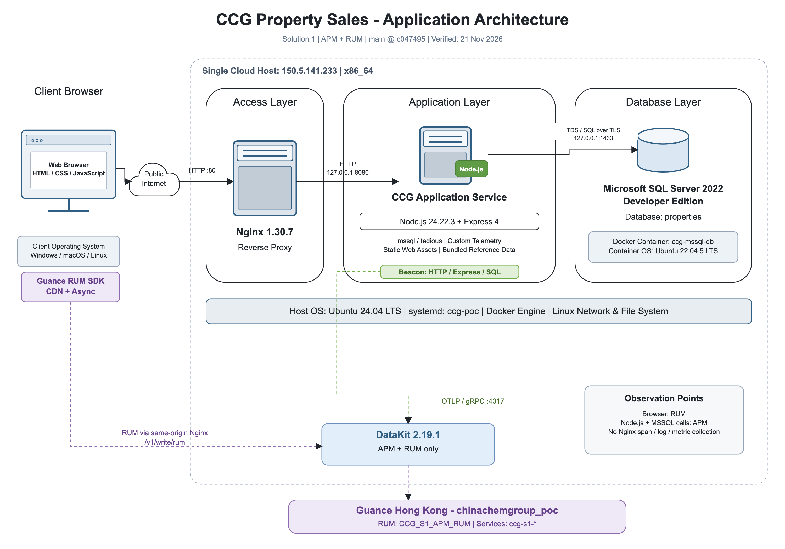

# Solution 1 — application changes for APM, RUM and session replay

This document compares the implementation with the customer's original MSSQL application at upstream main `c0474954a0f99882d0a468ec6557daedcfa76a25`. Deployment version: `s1-dataway-1.1.0`. Customer-reviewed implementation for Solution 1.

## Architecture

Business traffic: browser → Nginx → Node.js/Express → Microsoft SQL Server 2022. Browser telemetry and replay go directly to the Hong Kong RUM public DataWay; Beacon traces go directly to the Hong Kong OTLP DataWay. Workspace: `chinachemgroup_poc`.



[Editable draw.io](architecture/solution.drawio) · [SVG](architecture/solution.svg)

## Integration effort at a glance

The original business logic, APIs, SQL queries and database schema remain unchanged. Integration consists of three steps:

1. **Enable backend APM:** add the Beacon dependency and preload it through the application's startup configuration. HTTP, Express and SQL calls are instrumented automatically, without adding manual Spans to business code.
2. **Enable browser RUM and replay:** add the same two script references to each of the four HTML entry pages. A shared initializer loads the official SDK asynchronously from its CDN, enables 100% session/replay sampling, masks form inputs and connects browser requests to backend traces.
3. **Configure reporting parameters:** supply the workspace's DataWay address and the appropriate backend/browser tokens, then restart the application. Supplied scripts automate configuration generation and deployment; they are supporting delivery files, not additional business-code integration points.

**Application-level changes are limited to one dependency, shared browser integration files and two script references per HTML entry page.** Startup and reporting settings are deployment configuration. The existing custom telemetry module remains in place. Logs, infrastructure/runtime metrics and profiling are outside this option's collection scope.

The following sections provide the exact files and annotated snippets for technical review and reproduction.

## Annotated code: browser initialization

Added at `public/js/guance-rum.js`. The SDK is downloaded from the official CDN with `async=true`; initialization waits for the CDN SDK. `sessionSampleRate=100` and `sessionReplaySampleRate=100` include every eligible session in the sampling decision. `defaultPrivacyLevel='mask-user-input'` explicitly retains the SDK's default form-input masking policy. Recording starts after initialization:

```javascript
/* Solution 1: Guance RUM via the official CDN, loaded asynchronously.
 * This file is separate from the customer's custom /js/rum.js.
 */
(function (window, document) {
  'use strict';
  // Queue configuration until the CDN SDK has finished loading.
  window.DATAFLUX_RUM = window.DATAFLUX_RUM || {
    q: [], onReady: function (callback) { this.q.push(callback); }
  };
  var sdk = document.createElement('script');
  sdk.async = true; // Do not block HTML parsing while downloading the RUM SDK.
  sdk.src = 'https://static.guance.com/browser-sdk/v3/dataflux-rum.js';
  document.head.appendChild(sdk);
  window.DATAFLUX_RUM.onReady(function () {
    if (!window.CCG_RUM_CLIENT_TOKEN) return; // Fail closed until configured.
    window.DATAFLUX_RUM.init({
      applicationId: 'CCG_S1_APM_RUM', // Created in the Hong Kong workspace.
      site: 'https://cn6-rum-openway.guance.one', // Dedicated Hong Kong browser intake.
      clientToken: window.CCG_RUM_CLIENT_TOKEN, // Browser-scoped token from deployment config.
      service: 'ccg-s1-web', env: 'poc', version: 's1-dataway-1.1.0',
      sessionSampleRate: 100, // PoC only; choose a production sampling policy later.
      sessionReplaySampleRate: 100, // Record all sampled sessions.
      defaultPrivacyLevel: 'mask-user-input', // Default privacy: mask form inputs.
      trackUserInteractions: true,
      allowedTracingUrls: [window.location.origin + '/'], // Match this application only.
      traceType: 'w3c_traceparent', tracingSampleRate: 100 // Propagate to Beacon.
    });
    window.DATAFLUX_RUM.startSessionReplayRecording(); // Start after SDK initialization.
  });
})(window, document);
```

100% is a sampling configuration, not a guarantee against browser blocking, SDK-load failure, network loss or unsupported content. Recording begins after the SDK initializes; earlier activity cannot be recovered. Existing browser sessions may retain an earlier sampling decision; validate policy changes with a fresh session. Ordinary page text remains visible; form input values are masked, and password/sensitive-field protection still applies.

Added in each of the four HTML entry pages:

```html
<!-- Read the browser-scoped token before initializing the CDN SDK. -->
<script src="/js/guance-rum-config.js"></script>
<script src="/js/guance-rum.js"></script>
```

`prepare-dataway.py` generates `window.CCG_RUM_CLIENT_TOKEN` in the ignored browser configuration file. This is the RUM application's browser reporting token. The privileged backend workspace token is never served to the browser.

## Annotated code: automatic backend instrumentation

Add this dependency to the original application and update its lockfile:

```json
"@beacon-observability/nodejs": "2.0.2"
```

Install `beacon.conf` at `/etc/systemd/system/ccg-poc.service.d/observability.conf`. `NODE_OPTIONS` loads the agent before Express/MSSQL. The exporter uses HTTPS OTLP HTTP/protobuf. W3C propagation links browser requests to automatic HTTP/Express/tedious Spans:

```ini
# systemd drop-in: /etc/systemd/system/ccg-poc.service.d/observability.conf
[Service]
# Preload before Express and mssql are imported; no manual request/SQL spans.
Environment="NODE_OPTIONS=--require @beacon-observability/nodejs/register"
Environment="OTEL_SERVICE_NAME=ccg-s1-api"
Environment="OTEL_RESOURCE_ATTRIBUTES=env=poc,version=s1-dataway-1.1.0,service.version=s1-dataway-1.1.0,host.name=CCG-Mock-APM,solution=s1"
Environment="OTEL_EXPORTER_OTLP_ENDPOINT=https://cn6-openway.guance.one/otel"
Environment="OTEL_EXPORTER_OTLP_PROTOCOL=http/protobuf"
Environment="OTEL_PROPAGATORS=tracecontext,baggage"
Environment="OTEL_TRACES_EXPORTER=otlp"
Environment="OTEL_TRACES_SAMPLER=always_on"
Environment="OTEL_NODE_ENABLED_INSTRUMENTATIONS=http,express,tedious"
# Explicitly disable metrics, logs and profiling for this APM/RUM-only baseline.
Environment="OTEL_METRICS_EXPORTER=none"
Environment="OTEL_LOGS_EXPORTER=none"
Environment="OTEL_PROFILING_ENABLED=false"
Environment="OTEL_LOG_LEVEL=warn"

# Root-only backend authentication; never serve this file to browsers.
EnvironmentFile=/etc/ccg-observability/s1-otlp.env
```

The `/otel` base endpoint is expanded by the exporter to `/otel/v1/traces`. `/etc/ccg-observability/s1-otlp.env` supplies `OTEL_EXPORTER_OTLP_HEADERS=X-Token=<workspace-token>` and is mode 600. No credential values are included here.

## Parameters and their sources

| Parameter | Value / where to get it |
| --- | --- |
| Workspace | Hong Kong console workspace selector → chinachemgroup_poc |
| applicationId | RUM → Web application settings → CCG_S1_APM_RUM |
| site | Same application's public DataWay integration: https://cn6-rum-openway.guance.one |
| clientToken | Same application's Client Token; save to /etc/ccg-observability/s1-rum-client-token (600) |
| Backend DataWay URL/token | Target workspace Integrations → installation/reporting configuration; full DK_DATAWAY URL saved to /etc/ccg-observability/dataway.url (600) |
| OTLP endpoint | https://cn6-openway.guance.one/otel; DataWay must support OTLP HTTP/protobuf |
| SDK URL | Official Web RUM CDN integration guide; rolling v3 URL shown in bootstrap |
| Service names | Customer-defined ccg-s1-web and ccg-s1-api |
| version / env / solution | Customer-defined s1-dataway-1.1.0 / poc / s1 |
| host.name | Actual deployment identity, CCG-Mock-APM |
| allowedTracingUrls | Actual application origin, derived from window.location.origin; PoC http://150.5.141.233/ |
| Sampling / privacy | Customer policy: session=100, replay=100, trace=100, mask-user-input |
| APP_DIR / unit / user | Existing /opt/ccg-poc/NodeJS_MSSQL / ccg-poc / guance-poc |
| DB connection | Original MSSQL deployment, /etc/ccg-mssql/app.env; unchanged |

## Customer deployment steps

1. Prerequisites: original MSSQL application running, Node.js 24, npm, Nginx, systemd unit and SQL Server available. This package adds observability; it is not an OS/database installer.
2. Create or select the Web RUM app in the target workspace. Set applicationId, site, service, env and version in the provided files. For a different origin, review trace allowlisting and any CSP requirements for CDN, receiver and replay worker resources.
3. Store the full backend DataWay URL and browser Client Token in the root-only files listed above; directory mode 700, files mode 600. Never use the backend token as a browser clientToken. Review `prepare-dataway.py` hostname/path assertions for another region or deployment.
4. Install locked dependencies with `npm ci --omit=dev`; run `prepare-dataway.py` to generate configuration. Install the supplied systemd drop-in and business Nginx site, run `nginx -t`, reload systemd, restart ccg-poc and reload Nginx. The supplied deploy.sh automates these operations on this dedicated PoC host; review its host-specific service-management operations before applying it to shared environments.
5. Confirm `/api/health` reports `data_mode=mssql` and DB up. Open sales.html, wait for SDK initialization, reload the document list and open a document. In the target RUM app, inspect the matching session replay and resource trace. Use version s1-dataway-1.1.0 to isolate this deployment's data.
6. Rollback: restore the saved Nginx/systemd configuration and original HTML/dependency files, reload configuration and restart the app. Preserve SQL data and credentials.

## Evidence and review boundary

[evidence-dataway](evidence-dataway) contains workspace query records with exact time windows. RUM, replay and backend trace ingestion are checked against the target workspace. Existing evidence from other version tags must not be used as proof for this deployment. Direct OTLP backend records currently have a null Guance-specific span_type field in query results; trace_id/span_id/parent_id and SQL resources remain available. UI service-map rendering is not claimed as verified by the query evidence.

## Official references

- [Session replay startup and default privacy](https://docs.guance.com/en/real-user-monitoring/session-replay/web/data-integrity/)
- [Web RUM public DataWay integration](https://docs.guance.com/real-user-monitoring/web/app-access/)
- [OTLP DataWay routes and authentication](https://docs.guance.com/en/deployment/dataway/)

Replay verification: version `s1-dataway-1.1.0`, app `CCG_S1_APM_RUM`, session `de736f5f-08b8-4ed4-a435-8d943d6609b9`; multiple session_replay records were received in the Hong Kong workspace. See [replay evidence](evidence-dataway/replay-100/replay.json) and [live configuration check](evidence-dataway/replay-100/configuration.json).
