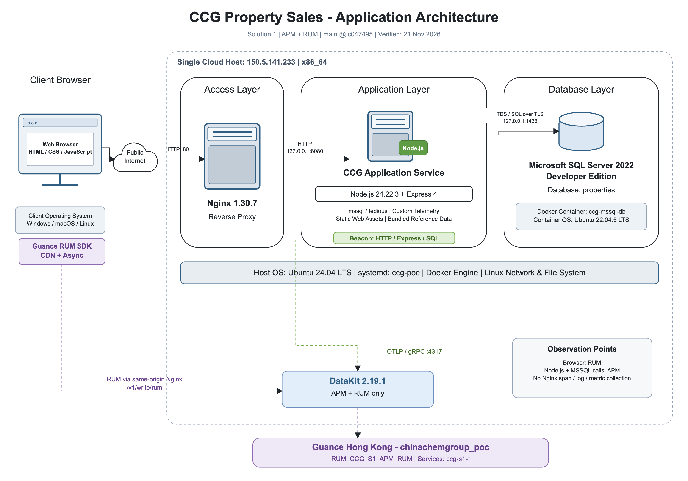

# 方案 1：APM、RUM 与会话重放改造说明

本文仅说明当前方案相对于客户原始 MSSQL 应用 main `c0474954a0f99882d0a468ec6557daedcfa76a25` 的改造。部署版本为 `s1-dataway-1.1.0`。本版方案已完成人工确认，用于方案 1 的 PR 交付。

## 架构与上报路径

业务访问：浏览器 → Nginx → Node.js/Express → Microsoft SQL Server 2022。

浏览器 RUM 与会话重放直接上报香港公网 RUM DataWay；后端 Beacon 链路通过 HTTPS OTLP HTTP/protobuf 直接上报香港 DataWay。目标空间为 `chinachemgroup_poc`。



[可编辑 draw.io](architecture/solution.drawio) · [SVG](architecture/solution.svg)

## 接入工作量说明

本次接入保留原有业务逻辑、API、SQL 查询和数据库表结构，主要完成以下三项工作：

1. **后端启用 APM 探针**：增加 Beacon 依赖，并通过应用启动参数加载。HTTP、Express 和 SQL 调用由探针自动追踪，无需在业务函数中手工添加 Span。
2. **前端接入 RUM 与会话重放**：在四个 HTML 入口中各增加相同的两行脚本引用，由共享初始化脚本从官方 CDN 异步加载 SDK，开启 100% 会话与重放采样、表单输入脱敏及前后端链路关联。
3. **配置上报参数并重启**：填写工作空间 DataWay 地址及前后端对应的 Token，使数据直接上报目标空间。随交付提供的脚本用于自动生成配置和执行部署，属于配套工具，无需逐个改造业务模块。

**应用层面的改动集中在一项依赖、共享前端接入文件，以及每个 HTML 入口的两行引用。** 其余是启动和上报配置。原有自定义监测模块保留，本方案不增加应用日志、基础设施/运行时指标及性能剖析采集。

以下保留实际修改位置和带注释代码，供技术人员核对与复现。

## 带注释的前端代码

新增位置：`public/js/guance-rum.js`。SDK 通过官方 CDN 异步下载，初始化在 SDK 就绪后执行。会话采样和会话重放采样均为 100；显式设置 SDK 默认隐私策略 `mask-user-input`，对表单输入值脱敏，普通页面文字保持可见。初始化后调用录制启动方法：

```javascript
/* Solution 1: Guance RUM via the official CDN, loaded asynchronously.
 * This file is separate from the customer's custom /js/rum.js.
 */
(function (window, document) {
  'use strict';
  // Queue configuration until the CDN SDK has finished loading.
  window.DATAFLUX_RUM = window.DATAFLUX_RUM || {
    q: [], onReady: function (callback) { this.q.push(callback); }
  };
  var sdk = document.createElement('script');
  sdk.async = true; // Do not block HTML parsing while downloading the RUM SDK.
  sdk.src = 'https://static.guance.com/browser-sdk/v3/dataflux-rum.js';
  document.head.appendChild(sdk);
  window.DATAFLUX_RUM.onReady(function () {
    if (!window.CCG_RUM_CLIENT_TOKEN) return; // Fail closed until configured.
    window.DATAFLUX_RUM.init({
      applicationId: 'CCG_S1_APM_RUM', // Created in the Hong Kong workspace.
      site: 'https://cn6-rum-openway.guance.one', // Dedicated Hong Kong browser intake.
      clientToken: window.CCG_RUM_CLIENT_TOKEN, // Browser-scoped token from deployment config.
      service: 'ccg-s1-web', env: 'poc', version: 's1-dataway-1.1.0',
      sessionSampleRate: 100, // PoC only; choose a production sampling policy later.
      sessionReplaySampleRate: 100, // Record all sampled sessions.
      defaultPrivacyLevel: 'mask-user-input', // Default privacy: mask form inputs.
      trackUserInteractions: true,
      allowedTracingUrls: [window.location.origin + '/'], // Match this application only.
      traceType: 'w3c_traceparent', tracingSampleRate: 100 // Propagate to Beacon.
    });
    window.DATAFLUX_RUM.startSessionReplayRecording(); // Start after SDK initialization.
  });
})(window, document);
```

100% 表示采样决策全量，并不保证绕过浏览器拦截、SDK 加载失败、网络丢包或浏览器能力限制。现存浏览器会话可能保留此前的采样决策，修改策略后应以全新会话验证。录制开始前的行为不会补录；密码与敏感输入仍受 SDK 的隐私保护规则约束。

四个 HTML 入口各新增两行引用：

```html
<!-- 在 CDN SDK 初始化前读取浏览器专用上报配置。 -->
<script src="/js/guance-rum-config.js"></script>
<script src="/js/guance-rum.js"></script>
```

部署脚本生成的配置文件定义 `window.CCG_RUM_CLIENT_TOKEN`，它只包含 RUM 应用的浏览器上报 Token。后端工作空间 Token 不会下发到浏览器。

## 带注释的后端代码与启动配置

应用增加依赖，并同步生成锁文件：

```json
"@beacon-observability/nodejs": "2.0.2"
```

`beacon.conf` 安装到 `/etc/systemd/system/ccg-poc.service.d/observability.conf`。`NODE_OPTIONS` 在 Express/MSSQL 加载前启用探针，无需在业务入口增加 import。W3C 请求头衔接浏览器与自动生成的 HTTP、Express、SQL Span：

```ini
# systemd drop-in: /etc/systemd/system/ccg-poc.service.d/observability.conf
[Service]
# Preload before Express and mssql are imported; no manual request/SQL spans.
Environment="NODE_OPTIONS=--require @beacon-observability/nodejs/register"
Environment="OTEL_SERVICE_NAME=ccg-s1-api"
Environment="OTEL_RESOURCE_ATTRIBUTES=env=poc,version=s1-dataway-1.1.0,service.version=s1-dataway-1.1.0,host.name=CCG-Mock-APM,solution=s1"
Environment="OTEL_EXPORTER_OTLP_ENDPOINT=https://cn6-openway.guance.one/otel"
Environment="OTEL_EXPORTER_OTLP_PROTOCOL=http/protobuf"
Environment="OTEL_PROPAGATORS=tracecontext,baggage"
Environment="OTEL_TRACES_EXPORTER=otlp"
Environment="OTEL_TRACES_SAMPLER=always_on"
Environment="OTEL_NODE_ENABLED_INSTRUMENTATIONS=http,express,tedious"
# Explicitly disable metrics, logs and profiling for this APM/RUM-only baseline.
Environment="OTEL_METRICS_EXPORTER=none"
Environment="OTEL_LOGS_EXPORTER=none"
Environment="OTEL_PROFILING_ENABLED=false"
Environment="OTEL_LOG_LEVEL=warn"

# Root-only backend authentication; never serve this file to browsers.
EnvironmentFile=/etc/ccg-observability/s1-otlp.env
```

基础地址 `/otel` 由导出器追加为 `/otel/v1/traces`。后端认证通过权限为 600 的 `/etc/ccg-observability/s1-otlp.env` 提供：`OTEL_EXPORTER_OTLP_HEADERS=X-Token=<工作空间 Token>`。文档和代码仓库不包含实际值。

## 参数值及获取位置

| 参数 | 本次值或获取方式 |
| --- | --- |
| 工作空间 | 香港控制台空间选择器 → chinachemgroup_poc |
| applicationId | 用户访问监测 → Web 应用设置 → CCG_S1_APM_RUM |
| site | 同一应用的公网 DataWay 接入配置 → https://cn6-rum-openway.guance.one |
| clientToken | 同一应用的 Client Token，保存到 /etc/ccg-observability/s1-rum-client-token，权限 600 |
| 后端 DataWay URL 与 Token | 目标工作空间「集成」中的安装/上报配置，完整 DK_DATAWAY URL 保存到 /etc/ccg-observability/dataway.url，权限 600 |
| OTLP 地址与协议 | https://cn6-openway.guance.one/otel、http/protobuf；接收端需支持 OTLP |
| SDK URL | 官方 Web RUM CDN 接入说明，初始化脚本中使用 v3 滚动版本地址 |
| 服务名 | 自定义，前端 ccg-s1-web、后端 ccg-s1-api |
| version、env、solution | 自定义，s1-dataway-1.1.0、poc、s1 |
| host.name | 实际部署主机标识，本次 CCG-Mock-APM |
| allowedTracingUrls | 实际应用访问源，本次由 window.location.origin 得到 http://150.5.141.233/ |
| 采样及隐私 | 会话 100、重放 100、链路 100；mask-user-input |
| 应用路径、服务与用户 | 现有 /opt/ccg-poc/NodeJS_MSSQL、ccg-poc、guance-poc |
| MSSQL 连接 | 原有 /etc/ccg-mssql/app.env，无需为观测改写 |

## 客户复现步骤

1. 前置条件：原应用已以 MSSQL 模式运行，已安装 Node.js 24、npm、Nginx，已有 systemd 应用服务及 SQL Server。本交付增加可观测配置，不承担操作系统和数据库安装。
2. 在目标空间创建或选择 Web RUM 应用，按表中来源填写应用 ID、接收地址、服务名、环境、版本。不同环境需检查访问源、链路允许列表，以及 CSP 对 CDN、上报接收端和重放 worker 的限制。
3. 将完整后端 DataWay URL 与浏览器 Client Token 分别写入上述 root-only 文件；目录权限 700、文件权限 600。不得将后端 Token 用作浏览器 Client Token。其他地域部署需调整 prepare-dataway.py 中的域名与路径校验。
4. 执行 npm ci --omit=dev 安装锁定依赖；执行 prepare-dataway.py 生成环境配置；安装 systemd drop-in 和业务 Nginx 配置；检查 nginx -t，重新加载 systemd，重启 ccg-poc 并重新加载 Nginx。deploy.sh 已在本台专用 POC 主机上自动化这些步骤；部署到共享主机前，应审核脚本中的主机服务管理操作。
5. 检查 /api/health 返回 data_mode=mssql、数据库正常。浏览器访问 sales.html，等待 SDK 初始化后重新载入文档列表并访问详情；在目标 RUM 应用查看会话重放及资源关联链路。通过 version=s1-dataway-1.1.0 区分本版本数据。
6. 回滚时恢复备份的 Nginx/systemd 配置及原始 HTML、依赖文件，重新加载配置并重启应用，保留 SQL 数据和凭据。

## 验证证据与边界

[evidence-dataway](evidence-dataway) 包含工作空间查询记录与准确时间范围。验证按版本标签区分，不以其他版本历史数据作为本次证明。当前直传后端记录的观测云 span_type 字段为空，但 trace_id、span_id、parent_id 及 SQL 资源存在；查询证据不等同于已验收控制台服务拓扑渲染效果。

官方参考：[会话重放启动与默认隐私策略](https://docs.guance.com/real-user-monitoring/session-replay/web/data-integrity/)、[Web RUM 公网接入](https://docs.guance.com/real-user-monitoring/web/app-access/)、[DataWay OTLP 地址及认证](https://docs.guance.com/deployment/dataway/)。

本次入库验证：版本 `s1-dataway-1.1.0`，应用 `CCG_S1_APM_RUM`，新会话 `de736f5f-08b8-4ed4-a435-8d943d6609b9` 已产生多条 session_replay 记录。详见 [真实重放查询证据](evidence-dataway/replay-100/replay.json) 和 [线上配置校验](evidence-dataway/replay-100/configuration.json)。
