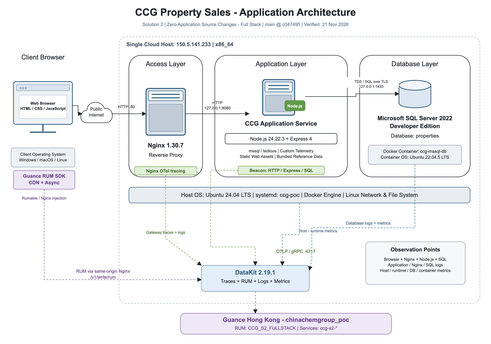
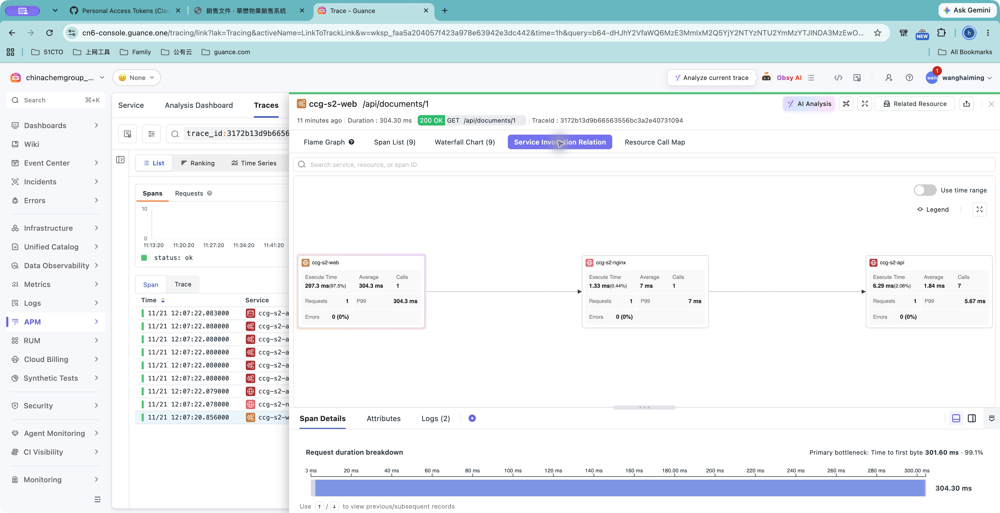
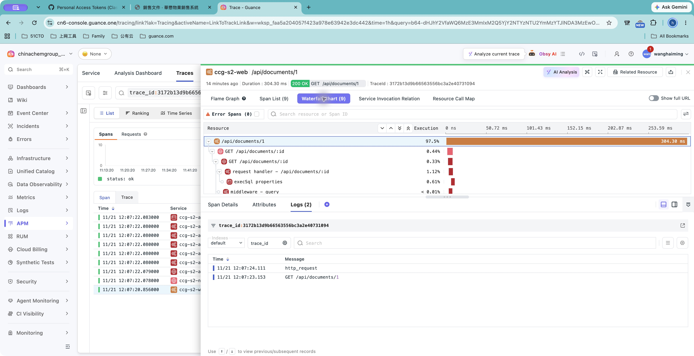
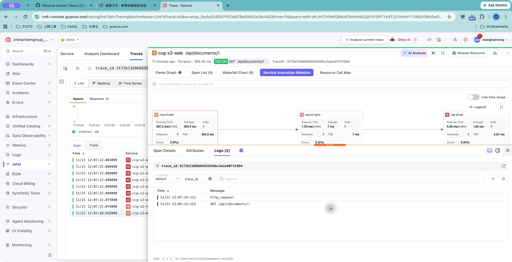
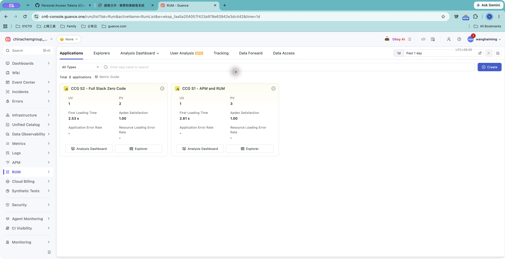
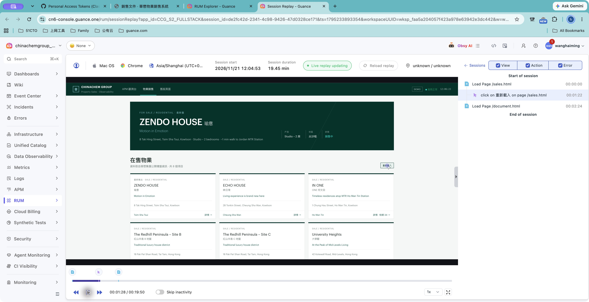

# Solution 2 — full-stack observability without application source changes

This independently deployable alternative starts from upstream main `c0474954a0f99882d0a468ec6557daedcfa76a25`. It observes the MSSQL application through Guance Hong Kong / `chinachemgroup_poc`. It is not an incremental patch on Solution 1: choose one solution at a time on this host.

## What does the customer have to change?

**No edits to `src/`, `public/`, `package.json` or the application lockfile.** All files in this PR are under `observability/solution-2`. Beacon is installed in a separate agent directory and preloaded at process startup. Rumable changes Nginx configuration and injects an initializer into HTML responses at runtime. The browser SDK itself downloads asynchronously from the official CDN.

“Zero application source changes” does not mean no integration code or infrastructure changes. The external `agent/correlate-logs.cjs` adapter is custom code: this application's logger is a bespoke JSON writer, so the adapter enriches its complete stderr JSON lines with the active OTel Trace/Span ID. It does not add manual business spans, replace the application logger, or edit its source. Nginx, systemd and DataKit configurations are changed, and a SQL monitoring login is created.

| Location added or configured | Purpose | Application source edits |
| --- | --- | --- |
| `/opt/ccg-observability/agent` | Separate Beacon installation and startup/log adapter | None |
| systemd `ccg-poc.service.d/observability.conf` | Preload Beacon before Express/tedious; runtime metrics; file output | None |
| `/etc/rumable/ccg-s2.toml`, Rumable-managed Nginx include | Runtime RUM injection, CDN async download and replay | None; response HTML is transformed |
| Nginx module + HTTP/server configuration | Gateway tracing, W3C propagation, JSON access logs, local stub_status | None |
| DataKit input configurations | OTLP, RUM/replay, file logs, host/container/Nginx/SQL metrics | None |
| SQL login `guance_monitor_s2` | Read monitoring state from SQL Server | No application queries/schema changed |

## Architecture and observation points



Editable [draw.io source](architecture/solution.drawio), [SVG](architecture/solution.svg), and [baseline](architecture/baseline.png). Browser/client OS, Nginx, Node.js/Express, SQL Server Docker/container OS and Ubuntu host OS remain visible. Bundled property reference data is still served from `src/data.js`; documents and health checks use MSSQL. No Redis, queue, or extra business microservice is invented.

## Annotated integration snippets

Paths below are relative to this directory unless an installed destination is shown. These are deployment additions; no import is inserted into the customer's entry point.

### 1. Backend automatic instrumentation

`agent/package.json` pins the external dependencies:

```json
{
  "name": "ccg-zero-code-observability-agent",
  "version": "1.0.0",
  "private": true,
  "dependencies": {
    "@beacon-observability/nodejs": "2.0.2",
    "@opentelemetry/api": "1.9.0"
  }
}
```

`agent/register.cjs` loads Beacon first, before the application imports Express or MSSQL. Beacon automatically instruments HTTP/Express and the actual `tedious` SQL driver:

```javascript
// External startup adapter: no import is added to the application entry point.
require('@beacon-observability/nodejs/register');
require('./correlate-logs.cjs');
```

`beacon.conf` is installed as a systemd drop-in. `NODE_OPTIONS` is the startup integration point; OTLP goes to the local DataKit. Trace context is W3C; metrics are enabled only in this full-stack option. Application logs use file collection, so the OTel log exporter is disabled. Profiling is outside this PoC.

```ini
# systemd drop-in: /etc/systemd/system/ccg-poc.service.d/observability.conf
[Service]
# Preload before Express and mssql are imported; no manual request/SQL spans.
Environment="NODE_OPTIONS=--require /opt/ccg-observability/agent/register.cjs"
Environment="OTEL_SERVICE_NAME=ccg-s2-api"
Environment="OTEL_RESOURCE_ATTRIBUTES=env=poc,version=s2-1.0.0,service.version=s2-1.0.0,host.name=CCG-Mock-APM,solution=s2"
Environment="OTEL_EXPORTER_OTLP_ENDPOINT=http://127.0.0.1:4317"
Environment="OTEL_EXPORTER_OTLP_PROTOCOL=grpc"
Environment="OTEL_PROPAGATORS=tracecontext,baggage"
Environment="OTEL_TRACES_EXPORTER=otlp"
Environment="OTEL_TRACES_SAMPLER=always_on"
Environment="OTEL_NODE_ENABLED_INSTRUMENTATIONS=http,express,tedious,runtime-node"
# Export runtime metrics; JSON application logs are tailed by DataKit.
Environment="OTEL_METRICS_EXPORTER=otlp"
Environment="OTEL_LOGS_EXPORTER=none"
Environment="OTEL_PROFILING_ENABLED=false"
Environment="OTEL_LOG_LEVEL=warn"
Environment="OTEL_METRIC_EXPORT_INTERVAL=15000"
StandardOutput=append:/var/log/ccg-s2/application.log
StandardError=append:/var/log/ccg-s2/application.log
```

### 2. RUM through Rumable / Nginx, CDN asynchronous

`rumable.toml` selects the public Nginx server. `sdk.source="cdn"` and `loading="async"` configure an asynchronous official-CDN script download. A same-origin endpoint forwards browser events to DataKit; the workspace write token never appears in browser code. `allowedTracingUrls` and `traceType` inject W3C headers into matching fetch/XHR requests. Replay masks form inputs (`mask-user-input`), while page text remains visible.

```toml
schemaVersion = 1
[[sites]]
id = "ccg-s2"
publicURL = "http://150.5.141.233/"
includePaths = ["/"]
probePaths = ["/", "/sales.html", "/document.html"]
[sites.nginx]
binary = "/usr/sbin/nginx"
args = ["-c", "/etc/nginx/nginx.conf"]
attachmentReviewed = false
[sites.sdk]
source = "cdn"
url = "https://static.guance.com/browser-sdk/v3/dataflux-rum.js"
loading = "async"
integrity = false
[sites.rum]
applicationId = "CCG_S2_FULLSTACK"
datakitOrigin = "http://150.5.141.233"
service = "ccg-s2-web"
env = "poc"
version = "s2-1.0.0"
sessionSampleRate = 100
sessionReplayEnabled = true
sessionReplaySampleRate = 100
defaultPrivacyLevel = "mask-user-input"
trackUserInteractions = true
allowedTracingUrls = ["http://150.5.141.233/"]
traceType = "w3c_traceparent"
tracingSampleRate = 100
```

Rumable writes the initializer and Nginx include under its state directory and attaches the include to the reviewed public server. The application HTML files on disk stay unchanged. The CDN v3 URL is rolling: this deployment resolved browser SDK **3.3.25**. Record and review the resolved version when reproducing. No SRI is requested for the rolling URL (`integrity=false`). CDN asynchronous loading can miss requests issued before initialization; reload the document list after the SDK has initialized to demonstrate association. Ordinary link navigation does not carry custom fetch headers.

### 3. Nginx tracing and access-log correlation

`nginx-tracing.conf` runs in the HTTP context. The native Nginx OTel module exports a gateway Span to DataKit. The route map normalizes document IDs. The access log records the gateway Trace/Span IDs, enabling the trace's Logs panel to retrieve the request record:

```nginx
# Nginx http context; the compatible ngx_otel_module must be loaded first.
otel_exporter {
    endpoint 127.0.0.1:4317;
    interval 1s;
    batch_size 64;
}
otel_service_name ccg-s2-nginx;
otel_resource_attr host.name CCG-Mock-APM;
otel_resource_attr env poc;
otel_resource_attr version s2-1.0.0;
otel_resource_attr solution s2;
map $uri $ccg_s2_route {
    ~^/api/documents/[0-9]+$ /api/documents/:id;
    default $uri;
}
map $status $ccg_s2_log_status {
    ~^5 error;
    ~^4 warn;
    default info;
}
log_format ccg_s2_json escape=json '{"timestamp":"$time_iso8601","message":"$request_method $uri","status":"$ccg_s2_log_status","http_status_code":$status,"duration_seconds":$request_time,"path":"$uri","trace_id":"$otel_trace_id","span_id":"$otel_span_id"}';
```

The key business location from `nginx-site.conf` continues the browser's trace, creates the gateway Span, and sends the updated context to Node.js:

```nginx
location / {
    otel_trace on;                    # Create a gateway Span.
    otel_trace_context propagate;     # Extract browser context and inject upstream context.
    otel_span_name "$request_method $ccg_s2_route";
    proxy_pass http://127.0.0.1:8080;  # Existing application service.
    # Forwarded headers are retained in the full configuration.
}
```

Telemetry receiver locations have tracing disabled. `127.0.0.1:8088/basic_status` is local-only and supplies gateway metrics. See the complete [site configuration](nginx-site.conf).

### 4. Existing application logs → active Trace/Span ID

`agent/correlate-logs.cjs` is the only custom runtime adapter. It recognizes the customer's complete JSON stderr lines, preserves other writes, and adds IDs only when an active valid Span exists. Startup/background records can legitimately have no trace ID. Its assumptions must be reviewed if the customer changes its logging implementation; a standard logger's supported instrumentation may replace it later.

```javascript
/* External adapter for the customer's existing JSON stderr logger.
 * Beacon handles traces; this adapter only enriches complete JSON log lines.
 * It does not modify src/server.js or introduce a new business logging API.
 */
'use strict';
const { context, trace, isSpanContextValid } = require('@opentelemetry/api');
const originalWrite = process.stderr.write;
process.stderr.write = function (chunk, encoding, callback) {
  let output = chunk;
  try {
    // The existing logLine writes one complete JSON string ending in a newline.
    if (typeof chunk === 'string' && chunk.endsWith('\n')) {
      const record = JSON.parse(chunk);
      if (record && record.ts && record.level && record.msg) {
        record.service = process.env.OTEL_SERVICE_NAME;
        record.status = record.level;
        record.message = record.msg;
        const span = trace.getSpan(context.active());
        const sc = span && span.spanContext();
        // Startup/background logs may have no request Span; never invent IDs.
        if (sc && isSpanContextValid(sc)) {
          record.trace_id = sc.traceId;
          record.span_id = sc.spanId;
        }
        output = JSON.stringify(record) + '\n';
      }
    }
  } catch (_) { /* Preserve non-JSON writes, buffers and partially written lines. */ }
  return originalWrite.call(this, output, encoding, callback);
};
```

`StandardOutput`/`StandardError` direct output to `/var/log/ccg-s2/application.log`; DataKit reads it as JSON fields. The first collector is:

```toml
[[inputs.logging]]
  logfiles = ["/var/log/ccg-s2/application.log"] # Existing process output, enriched externally.
  source = "ccg-s2-app"
  service = "ccg-s2-api"                      # Same service as the backend Spans.
  json_as_fields = true                     # Preserve trace_id/span_id as searchable fields.
  enable_multiline = false
  from_beginning = true
```

See [logging.conf](logging.conf) for Nginx access/error logs and SQL Server errorlog, and [logrotate.conf](logrotate.conf) for rotation. SQL error logs and unstructured Nginx errors normally have no request Trace ID; they correlate through service/host/time. Do not claim every infrastructure log belongs to a trace.

### 5. Metrics and common dimensions

DataKit collects CPU, memory, disk, disk I/O, network, system/process/host inventory and Docker metrics. Beacon exports Node.js runtime/HTTP metrics through OTLP. The Nginx collector polls local stub_status. The native SQL Server collector uses a dedicated monitoring login; `configure-sqlserver.py` creates the account and writes a root-only collector configuration. It does not grant application data write permissions.

Common dimensions are `host=CCG-Mock-APM`, `env=poc`, `version=s2-1.0.0`, `solution=s2` where supported, with service-specific names below. OTel runtime metrics use **`service_name`**, whereas APM/logs and native component metrics generally use **`service`**. Correlate runtime metrics using `service_name=ccg-s2-api`; host metrics using host/solution; SQL metrics using `service=ccg-s2-sqlserver`. Aggregate metrics have no per-request Trace ID or exemplars configured in this PoC. Log/trace association is exact by Trace ID; metric association is by shared dimensions and time.

| Signal | Name / source |
| --- | --- |
| RUM app / browser | `CCG_S2_FULLSTACK` / `ccg-s2-web` |
| APM Node.js | `ccg-s2-api` |
| Nginx APM/logs/metrics | `ccg-s2-nginx` |
| SQL Server metrics/error logs | `ccg-s2-sqlserver` |
| Application logs | source `ccg-s2-app`, service `ccg-s2-api` |
| Host / container | `CCG-Mock-APM` / `ccg-mssql-db` |

SQL exit Spans keep service `ccg-s2-api` (`spilt_service_name=false` in this DataKit version) and identify the database in Span attributes. They are not a separate database process Span. This naming choice does not remove the SQL child Span.

## Parameters: where customers get each value

| Parameter / file | Value in this PoC | Obtain or choose it |
| --- | --- | --- |
| Workspace | Hong Kong `chinachemgroup_poc` | Hong Kong console workspace selector; verify before copying any token |
| DataWay full URL | Secret; never committed | Guance Integrations → DataKit installation → copy `DK_DATAWAY`; save full URL in `/etc/ccg-observability/dataway.url`, root-only mode 600 |
| RUM applicationId | `CCG_S2_FULLSTACK` | RUM → Create Web application → copy applicationId; create a separate app from S1 |
| SDK URL | `https://static.guance.com/browser-sdk/v3/dataflux-rum.js` | Official Web RUM CDN integration snippet; rolling v3 version |
| publicURL/datakitOrigin/allowedTracingUrls | `http://150.5.141.233` | Actual customer browser origin including scheme/port; update together in Rumable config |
| service/env/version/solution | `ccg-s2-*`, `poc`, `s2-1.0.0`, `s2` | Customer-defined naming convention; update consistently across agent/Nginx/DataKit/RUM |
| host.name | `CCG-Mock-APM` | Actual host identity and DataKit host tag; retain consistent identity across signals |
| OTLP endpoint | `127.0.0.1:4317` | Local DataKit OpenTelemetry input; not a public endpoint |
| RUM receiver | same-origin `/v1/write/rum` and `/v1/write/rum/replay` | DataKit RUM input + supplied Nginx proxy configuration |
| APP_DIR / systemd unit / user | `/opt/ccg-poc/NodeJS_MSSQL`, `ccg-poc`, `guance-poc` | Existing deployment; adapt deploy.sh and drop-in paths for a different server |
| SQL host/database | `127.0.0.1:1433` / `properties` | Existing MSSQL deployment and app connection settings |
| SQL monitor password | Generated; root-only `/etc/ccg-mssql/monitor-s2.password` | Generated by configure-sqlserver.py; never put it in Git or browser code |
| SQL bootstrap admin password | Existing container environment | Existing SQL Server admin secret, consumed inside Docker; not printed by the script |
| SQL log path | `/var/lib/docker/volumes/ccg-mssql-data/_data/log/errorlog` | `docker volume inspect ccg-mssql-data`; adapt for bind mounts/remote SQL |
| Docker socket | `/var/run/docker.sock` | Existing local Docker daemon; collector needs access |
| Read-only query API key | Not required for collection | Workspace Management → API Keys; supply separately to Owl to validate ingestion |

SQL monitoring uses encrypted transport with a trusted self-signed local server certificate in this demo. In customer environments, use a trusted SQL certificate and appropriate validation settings. The application health response's original `env=local` is customer business configuration; observability tags deliberately use `poc` and do not rewrite that response.

## Reproduction on this deployment baseline

Prerequisites: the upstream MSSQL app is already running, `ccg-poc` systemd unit exists, Docker SQL Server `ccg-mssql-db` and database `properties` exist, DataKit is installed, and the official Rumable 0.1.11 binary is at `/opt/rumable/0.1.11/rumable`. This deployment used Node 24.22.3, Nginx 1.30.7 + compatible official `ngx_otel_module` 0.1.2, DataKit 2.19.1 and Beacon 2.0.2. Install the module from the official Nginx repository matching the Nginx build, enable its `load_module` directive, and verify `nginx -t`. Obtain DataKit/Rumable packages and installation commands from the official Guance Integrations/documentation for the host OS. This repository is an observability overlay, not an OS/database installer.

1. Check out this PR branch from the upstream baseline; start the app in MSSQL mode using the existing deployment. If switching from S1, first restore its modified HTML/dependency files to baseline, stop its old preload and remove the S1-only bootstrap from the active web root after backing it up. Do not stack both RUM initializers or both Beacon preloads.
2. Create the S2 Web RUM app in the correct Hong Kong workspace. Set the application ID and browser origin in `rumable.toml`; adjust deployment paths and host/service tags for the customer's environment.
3. Put the correct workspace's full DataWay URL in `/etc/ccg-observability/dataway.url` (directory 700, file 600). Do not reuse a token from another workspace.
4. Review `configure-datakit.py`: it stops the dedicated PoC collector, backs up active configurations under `/root/ccg-observability-backups/s2-*`, enables the listed full-stack inputs and updates the destination. On a shared collector, merge the inputs instead of replacing its active configuration set. WAL is preserved because S1 and S2 report to the same workspace; when changing workspace, quarantine old WAL first to prevent cross-workspace replay.
5. Review SQL monitoring permissions and file paths, then run as root:

```bash
cd /opt/ccg-poc/NodeJS_MSSQL
bash observability/solution-2/deploy.sh
```

The script installs the agent separately, creates monitoring access, installs the supplied configurations, checks Nginx, restarts the app/DataKit, reloads Nginx, and invokes Rumable setup with `--target /etc/nginx/sites-available/guance-poc:1`. The explicit target selects the public server rather than the local metrics server. For a different site, use Rumable's discovered server target, review the planned changes, and adapt the path/line target before applying. Keep DataKit and SQL ports local.

6. Check `systemctl is-active ccg-poc datakit nginx`, `/api/health` (`data_mode=mssql`, `db.up=true`), local stub_status, Rumable status, and actual public HTML for the `data-rumable` marker. Open `/sales.html` in a real browser, wait for the CDN SDK, press reload, and open a document. Do not use curl alone to validate RUM/replay.
7. In Guance, select the target workspace and app. Find a document fetch resource, open its associated trace, inspect browser → Nginx → Node.js → SQL, then open Logs. Inspect Node runtime, SQL and host/container metrics in the same time range. Open the recorded session replay.

Rollback: detach the `ccg-s2` Rumable attachment, restore the backed-up Nginx/DataKit/systemd files, remove the S2 preload from the unit, reload systemd and restart the affected services. Preserve the SQL data volume and application secrets. The SQL monitoring login can remain unused or be removed by the DBA after confirming no collector still needs it. A restart is required to unload Node instrumentation.

## Verified result — 21 November 2026

The [evidence directory](evidence) contains real Hong Kong workspace query results. Every included DQL was checked before execution; each JSON records the query and exact millisecond window. These are point-in-time PoC samples, not load-test or availability guarantees.

A browser document request produced Trace ID **`3172b13d9b66563556bc3a2e40731094`**, browser Span **`56bc3a2e40731094`**, session **`de2fc42d-2341-4c98-9426-47d0328ce171`**. The 9-Span chain includes browser, Nginx, Node/Express and an independent `execSql properties` exit Span. Two request logs share this exact trace: the application `http_request` record and Nginx `GET /api/documents/1`. Query evidence: [resource](evidence/resources.json), [chain](evidence/correlated-chain.json), [logs](evidence/correlated-logs.json).

### Real console service invocation and log association



The map groups by service, so SQL stays within `ccg-s2-api`. The waterfall shows the actual SQL child Span:





### Real RUM applications and replay



RUM includes sessions, views, resources, actions, long tasks and session_replay records for `CCG_S2_FULLSTACK`. Replay uses the configured form-input masking policy. Playback was opened and exercised in the real Guance console:



### Metrics / logs checked in the target workspace

| Evidence | Observed sample |
| --- | --- |
| Host CPU | CPU utilization sample with `solution=s2` |
| SQL Server | 3 user connections; server_memory 2097152 (collector's native unit) |
| Node runtime | event-loop utilization sample present; heap metric is dimensional, not a single total |
| Docker | `ccg-mssql-db` memory usage 963473408 bytes |
| Nginx | active connections and cumulative request count present |
| Trace-derived | request hits / latency count present for `ccg-s2-api` |
| Logs | app, Nginx access and SQL errorlog sources present |

Metric evidence is in the corresponding `*-metrics.json` files; values vary as traffic continues. Request association is demonstrated with exact Trace/Span IDs. Metrics use service/host/time dimensions; this delivery does not claim per-request metric exemplars. SQL errorlog history can predate this deployment because the collector reads the existing file from its beginning; the observation time and event time should be distinguished.

The application's built-in telemetry.js and `/api/rum` remain customer code and continue running; they are separate from the Guance SDK/Beacon. Their requests can appear as traced business endpoints. No synthetic manual Span was inserted to represent them.

## Official installation / configuration references

- [Beacon automatic instrumentation](https://docs.guance.com/en/beacon/)
- [Rumable prerequisites and installation](https://docs.guance.com/en/real-user-monitoring/web/rumable/)
- [Rumable CDN and SDK configuration](https://docs.guance.com/en/real-user-monitoring/web/rumable/configuration/)
- [DataKit installation](https://docs.guance.com/en/getting-started/get-started-with-datakit/)

The bundled configuration and recorded versions describe the tested deployment. Adapt current vendor installation commands to the customer's OS and package versions.
