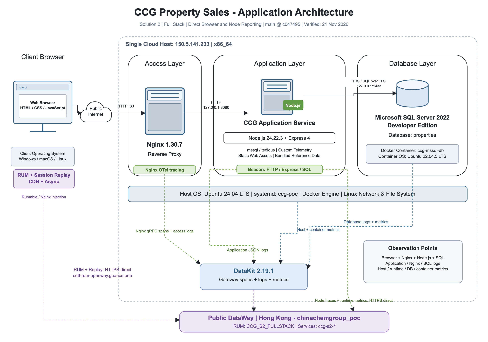

# 方案 2：全栈可观测改造说明

本文仅对照客户原始 MSSQL 应用 main `c0474954a0f99882d0a468ec6557daedcfa76a25` 说明当前改造。部署版本 `s2-dataway-1.1.0`。

## 接入工作量：三项操作

1. **启用外置后端探针**：在应用目录外安装 Beacon，通过启动配置预加载，自动追踪 HTTP、Express、tedious。外部日志适配器为原有 JSON 日志补充有效的 Trace/Span ID。
2. **在网关注入前端监测**：Rumable/Nginx 在 HTML 响应中注入共享初始化脚本，SDK 从官方 CDN 异步下载。会话与重放采样均为 100%，使用默认 `mask-user-input`，表单输入脱敏、普通页面文字可见。
3. **配置全栈采集与上报**：开启 Nginx 原生链路、日志采集、主机及组件指标，并配置目标空间的上报参数。

**客户应用业务源码、磁盘上的 HTML、package.json 和锁文件均无需修改。** 所有交付内容位于 `observability/solution-2`。需要明确：启动/组件配置属于部署操作；外部日志适配器仍是新增代码，不能把“业务源码零修改”解释成任何层面都没有代码。原 API、SQL 查询、表结构、数据库凭据和自带监测模块保持原样。

## 全栈观测架构



[可编辑 draw.io](architecture/solution.drawio) · [SVG](architecture/solution.svg)

图中保留浏览器及客户端操作系统、Nginx、Node.js/Express、SQL Server、Docker/容器操作系统和 Ubuntu 主机。实线是业务请求，彩色虚线是观测数据流。

- 浏览器 RUM/会话重放 → 香港 RUM 公网 DataWay → 华懋空间。
- Beacon 的 Node.js 链路与运行时指标 → HTTPS OTLP HTTP/protobuf DataWay → 华懋空间。
- Nginx Span → 本机 DataKit gRPC 接收器 → DataWay → 华懋空间。原生 Nginx 模块仅支持 OTLP/gRPC，需要此协议转发路径。
- 应用/Nginx/SQL 日志文件，以及主机、容器、Nginx、SQL 指标 → DataKit → DataWay → 华懋空间。

DataKit 在当前架构中承担主机/组件采集及 Nginx 协议转发，浏览器和 Node.js 链路不经过它。MSSQL 调用由 tedious 自动探针生成子 Span；SQL 组件指标和错误日志是另一类观测信号。原 data.js 中的参考楼盘数据仍保留；文档查询和数据库健康检查使用 MSSQL。

## 注释代码与实际修改位置

### 后端：外置安装及启动配置

`agent/package.json` 将 Beacon 2.0.2 和 OTel API 安装在 `/opt/ccg-observability/agent`，不加入客户应用依赖。启动时预加载 `agent/register.cjs`：

```javascript
// External startup adapter: no import is added to the application entry point.
require('@beacon-observability/nodejs/register');
require('./correlate-logs.cjs');
```

`beacon.conf` 安装到 `/etc/systemd/system/ccg-poc.service.d/observability.conf`。NODE_OPTIONS 在业务模块之前加载探针；配置 W3C 关联及 HTTPS HTTP/protobuf 上报。运行时指标开启，日志按文件采集，性能剖析关闭：

```ini
# systemd drop-in: /etc/systemd/system/ccg-poc.service.d/observability.conf
[Service]
# Preload before Express and mssql are imported; no manual request/SQL spans.
Environment="NODE_OPTIONS=--require /opt/ccg-observability/agent/register.cjs"
Environment="OTEL_SERVICE_NAME=ccg-s2-api"
Environment="OTEL_RESOURCE_ATTRIBUTES=env=poc,version=s2-dataway-1.1.0,service.version=s2-dataway-1.1.0,host.name=CCG-Mock-APM,solution=s2"
Environment="OTEL_EXPORTER_OTLP_ENDPOINT=https://cn6-openway.guance.one/otel"
Environment="OTEL_EXPORTER_OTLP_PROTOCOL=http/protobuf"
Environment="OTEL_PROPAGATORS=tracecontext,baggage"
Environment="OTEL_TRACES_EXPORTER=otlp"
Environment="OTEL_TRACES_SAMPLER=always_on"
Environment="OTEL_NODE_ENABLED_INSTRUMENTATIONS=http,express,tedious,runtime-node"
# Export runtime metrics; JSON application logs are tailed by DataKit.
Environment="OTEL_METRICS_EXPORTER=otlp"
Environment="OTEL_LOGS_EXPORTER=none"
Environment="OTEL_PROFILING_ENABLED=false"
Environment="OTEL_LOG_LEVEL=warn"
Environment="OTEL_METRIC_EXPORT_INTERVAL=15000"
StandardOutput=append:/var/log/ccg-s2/application.log
StandardError=append:/var/log/ccg-s2/application.log

# Backend-only DataWay authentication.
EnvironmentFile=/etc/ccg-observability/s2-otlp.env
```

prepare-dataway.py 生成 root-only `/etc/ccg-observability/s2-otlp.env`，提供 `OTEL_EXPORTER_OTLP_HEADERS=X-Token=<工作空间 Token>`。导出器自动将 /otel 补为 /otel/v1/traces 或 /otel/v1/metrics；后端 Token 不下发浏览器。

### 前端：CDN 异步与默认输入脱敏

rumable.toml 是部署模板，prepare-dataway.py 将浏览器专用 Client Token 写入 root-only `/etc/rumable/ccg-s2.toml`。实际值不进入仓库。Rumable 在公开 Nginx server 中挂载初始化脚本，客户原始 HTML 不变：

```toml
schemaVersion = 1
[[sites]]
id = "ccg-s2-dataway"
publicURL = "http://150.5.141.233/"
includePaths = ["/"]
probePaths = ["/", "/sales.html", "/document.html"]
[sites.nginx]
binary = "/usr/sbin/nginx"
args = ["-c", "/etc/nginx/nginx.conf"]
attachmentReviewed = false
[sites.sdk]
source = "cdn"
url = "https://static.guance.com/browser-sdk/v3/dataflux-rum.js"
loading = "async"
integrity = false
[sites.rum]
applicationId = "CCG_S2_FULLSTACK"
site = "https://cn6-rum-openway.guance.one"
clientToken = "__RUM_CLIENT_TOKEN__"
service = "ccg-s2-web"
env = "poc"
version = "s2-dataway-1.1.0"
sessionSampleRate = 100
sessionReplayEnabled = true
sessionReplaySampleRate = 100
defaultPrivacyLevel = "mask-user-input"
trackUserInteractions = true
allowedTracingUrls = ["http://150.5.141.233/"]
traceType = "w3c_traceparent"
tracingSampleRate = 100
```

sessionReplayEnabled=true 使 Rumable 在初始化后启动录制；sessionSampleRate 和 sessionReplaySampleRate 均为 100。显式 defaultPrivacyLevel=mask-user-input 保留 SDK 默认表单输入脱敏策略。100% 是采样决策全量，不保证绕过浏览器拦截、SDK 下载失败、网络丢包或能力限制；初始化之前的操作不会补录。验证采样策略时使用新会话。CDN v3 为滚动版本地址，实际 SDK 版本应在部署时记录。

### Nginx：网关 Span 与访问日志

nginx-tracing.conf 配置原生 OTel 模块、gRPC 导出和包含 $otel_trace_id/$otel_span_id 的 JSON 访问日志。nginx-site.conf 的业务 location 核心配置如下：

```nginx
location / {
    otel_trace on;                    # 创建网关 Span。
    otel_trace_context propagate;     # 提取浏览器上下文并向 Node.js 传播。
    otel_span_name "$request_method $ccg_s2_route";
    proxy_pass http://127.0.0.1:8080;  # 原业务服务。
    # 完整文件还保留转发请求头配置。
}
```

otel_exporter 指向本机 127.0.0.1:4317，opentelemetry.conf 配置接收器。Nginx 指标接口 127.0.0.1:8088/basic_status 仅供本机访问，不通过公网业务代理开放。

### 日志：外部适配，不改业务日志调用

客户使用自定义 JSON stderr 日志函数，agent/correlate-logs.cjs 在完整输出行处补充当前有效 Span 的 ID，保留其他类型输出。启动/后台日志可能没有请求上下文，不会虚构 Trace ID：

```javascript
/* External adapter for the customer's existing JSON stderr logger.
 * Beacon handles traces; this adapter only enriches complete JSON log lines.
 * It does not modify src/server.js or introduce a new business logging API.
 */
'use strict';
const { context, trace, isSpanContextValid } = require('@opentelemetry/api');
const originalWrite = process.stderr.write;
process.stderr.write = function (chunk, encoding, callback) {
  let output = chunk;
  try {
    // The existing logLine writes one complete JSON string ending in a newline.
    if (typeof chunk === 'string' && chunk.endsWith('\n')) {
      const record = JSON.parse(chunk);
      if (record && record.ts && record.level && record.msg) {
        record.service = process.env.OTEL_SERVICE_NAME;
        record.status = record.level;
        record.message = record.msg;
        const span = trace.getSpan(context.active());
        const sc = span && span.spanContext();
        // Startup/background logs may have no request Span; never invent IDs.
        if (sc && isSpanContextValid(sc)) {
          record.trace_id = sc.traceId;
          record.span_id = sc.spanId;
        }
        output = JSON.stringify(record) + '\n';
      }
    }
  } catch (_) { /* Preserve non-JSON writes, buffers and partially written lines. */ }
  return originalWrite.call(this, output, encoding, callback);
};
```

systemd 将输出写入 /var/log/ccg-s2/application.log；logging.conf 将 JSON 展开为字段，service=ccg-s2-api，与后端链路一致。同一文件还配置 Nginx 访问/错误日志及 SQL errorlog，logrotate.conf 负责轮转。数据库错误日志及非结构化 Nginx 错误日志通常没有请求 Trace ID，按组件/主机/时间关联。客户日志格式变化时应审核该外部适配器。

### 指标与关联方式

主机 CPU、内存、磁盘、I/O、网络、进程、Docker、Nginx 和 SQL Server 指标由原生采集器读取。configure-sqlserver.py 创建独立监控账号，密码只写 root-only 文件，授予监控状态读取权限，不增加业务数据写权限。Node.js 运行时/HTTP 指标由 Beacon 直接通过 OTLP 上报。

请求日志与链路通过 trace_id/span_id 精确关联；指标按 service/host/time 关联，本方案不配置每请求 exemplar。OTLP 与原生指标的维度名可能不同，例如 service_name 与 service，应以实际返回字段核对。SQL 子 Span 保留 ccg-s2-api 服务名，不虚构单独的 SQL Server 进程探针。网关派生请求指标对应网关接收的 Span 流。

## 参数与获取位置

| 参数 | 当前值或来源 |
| --- | --- |
| 空间 | 香港控制台空间选择器 → chinachemgroup_poc |
| RUM applicationId | 用户访问监测 → Web 应用设置 → CCG_S2_FULLSTACK |
| RUM site / Client Token | 同一应用公网接入配置，https://cn6-rum-openway.guance.one；浏览器 Token 写入 /etc/ccg-observability/s2-rum-client-token，权限 600 |
| 后端/采集器 DataWay URL | 目标空间「集成」安装/上报配置中的完整 DK_DATAWAY URL，存入 /etc/ccg-observability/dataway.url，权限 600 |
| OTLP 地址与协议 | https://cn6-openway.guance.one/otel、http/protobuf，后端 Token 提取到 s2-otlp.env |
| SDK URL | 官方 Web RUM CDN 接入说明；模板使用 v3 滚动地址 |
| 服务名 | 自定义：ccg-s2-web、ccg-s2-api、ccg-s2-nginx、ccg-s2-sqlserver |
| 环境/版本/solution | 自定义 poc、s2-dataway-1.1.0、s2；在配置中保持一致 |
| 访问源/允许列表 | 实际客户访问源；同步修改 publicURL 和 allowedTracingUrls |
| 采样与隐私 | 会话/重放/链路均 100，mask-user-input |
| 主机 | 实际主机标识，本次 CCG-Mock-APM |
| 应用路径/服务/用户 | 原部署 /opt/ccg-poc/NodeJS_MSSQL、ccg-poc、guance-poc |
| Nginx 挂载目标 | Rumable 发现的公开 server，本次 /etc/nginx/sites-available/guance-poc:1 |
| 本机采集端口 | 4317 gRPC、8088 指标；仅内部访问 |
| SQL 连接 | 原数据库 127.0.0.1:1433、properties |
| SQL 监控密码 | configure-sqlserver.py 生成，/etc/ccg-mssql/monitor-s2.password，权限 600 |
| SQL 初始管理凭据 | 原 SQL 容器管理员环境变量，在容器内使用 |
| SQL 日志/Docker socket | 现有 ccg-mssql-data 卷内 log/errorlog、/var/run/docker.sock；按客户环境调整 |
| 查询 API Key | 空间「管理 → API Keys」单独提供只读查询权限，与上报认证分开 |

## 原始应用上的实施步骤

1. 前置条件：原应用以 MSSQL 模式运行；已有 Node 24.22.3、Nginx 1.30.7 与匹配的官方 ngx_otel_module 0.1.2、sub_filter，DataKit 2.19.1、Rumable 0.1.11、systemd、SQL Server 2022 Docker。安装包按官方来源及客户 OS/构建版本匹配。本交付是观测接入，不承担基础 OS/数据库安装。
2. 审核路径、域名校验、服务名和访问源。分别准备 root-only 后端 DataWay URL 与浏览器 Client Token 文件，目录 700、文件 600，二者不可混用。
3. 先备份现有 Nginx 站点和 systemd drop-in。若在已有同名挂载的站点重复部署，先执行 rumable uninstall --config /etc/rumable/ccg-s2.toml --state-dir /var/lib/rumable --site ccg-s2-dataway --yes，解除受管挂载后再替换 Nginx 文件。从原始应用基线出发，以 root 执行：

```bash
cd /opt/ccg-poc/NodeJS_MSSQL
bash observability/solution-2/deploy.sh
```

脚本单独安装 agent，备份并配置本台专用采集器，建立 SQL 监控账号，生成运行配置，安装 systemd/Nginx 配置，启动服务，并以 ccg-s2-dataway 站点挂载 Rumable。共享采集器应按需合并输入配置；切换工作空间前隔离旧队列，避免历史数据进入其他空间。

4. 检查 MSSQL 健康、nginx -t、本机指标接口，以及公开页面是否只有预期的 Rumable 注入。使用新浏览器会话，等待 SDK 后重新加载文档并访问详情；在目标空间核实重放、浏览器 → Nginx → Node → SQL 链路、关联日志和同时间段指标。
5. 回滚时先保留运行配置，再卸载本次 Rumable 挂载，恢复 Nginx/systemd/采集器备份并重启相关服务。保留 SQL 数据卷与凭据；Node 探针需要进程重启才能卸载。

## 验证证据

当前版本证据单独保存在 evidence-current，按准确时间和版本标签核验。后端直传记录中的观测云 span_type 可能为空，但 ID 和父子关系仍存在；不得据查询证据夸大控制台渲染效果。

官方依据：[Nginx 原生追踪及 gRPC](https://nginx.org/en/docs/ngx_otel_module.html)、[Rumable CDN/异步配置](https://docs.guance.com/en/real-user-monitoring/web/rumable/configuration/)、[重放默认隐私](https://docs.guance.com/real-user-monitoring/session-replay/web/data-integrity/)、[DataWay OTLP](https://docs.guance.com/deployment/dataway/)。

### 实际验收样本（2026 年 11 月 21 日）

- Trace `556f1229bf568c7d27f7831f7c58ae1c` 含 10 个 Span，连接浏览器、Nginx、Node/Express 和两次 SQL 调用。
- 同一 Trace ID 查询到三条日志：网关访问、应用 http_request、应用 db_query。
- 版本 s2-dataway-1.1.0 的会话 `94f45fae-e24b-4631-b638-ab5244eff662` 已收到重放数据；线上初始化脚本已核实 100% 采样、mask-user-input 和录制启动。
- 已查询主机、容器、Nginx、SQL、Node 运行时指标。SQL 日志通过一条明确标记的 informational 验证消息确认采集成功，该消息为主动测试，并非数据库故障。
- 12 项 HTTP 状态检查、四项公开页面注入检查、应用源码及依赖文件与原始应用的一致性检查均通过。

原始查询、语法校验及准确时间范围见 evidence-current；指标是验证时点样本，不包含每请求 exemplar。

### 已有会话重放复核（2026 年 11 月 21 日）

21:43 的会话最初有 RUM、没有重放，虽然采样配置为 100%。在该浏览器会话中，`isRecording()` 为 false；调用官方 `startSessionReplayRecording({force:true})` 后恢复录制，刷新后仍正常。目标空间随后收到同一会话的 33 条重放记录，关联 view 已有 `session_has_replay=1`。此次恢复未修改应用代码或服务器配置；之前未录制的操作无法补回。保留的会话录制资格是推断原因，尚未证实具体内部状态。部署验收需同时检查新会话、实际录制状态与空间侧重放数据。
