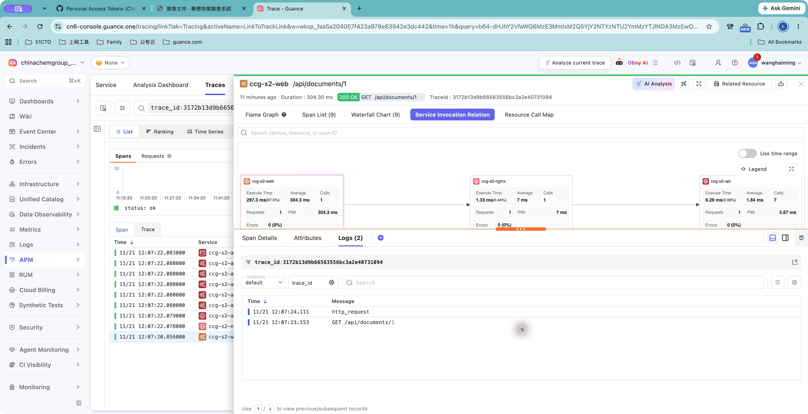

# 方案 2：全栈观测改造说明

本方案基于客户 main `c047495`，与方案 1 是两条独立分支，不能叠加部署。应用仍使用 MSSQL。

**客户业务源码、HTML/浏览器业务脚本、应用 package.json 和锁文件都没有修改。** 本 PR 只添加 `observability/solution-2`。具体改造如下：

| 改造位置 | 作用 | 是否写代码 |
| --- | --- | --- |
| 外置 agent/package.json、register.cjs | 安装并在应用启动前预加载 Beacon，自动追踪 HTTP、Express、tedious | 新增外部启动代码；业务源码不改 |
| 外置 agent/correlate-logs.cjs | 为客户自定义 JSON stderr 日志补充有效的 Trace/Span ID | **新增自定义适配代码，不能笼统称为完全没有代码** |
| systemd 启动配置 | NODE_OPTIONS、服务名、OTLP 地址、指标导出、日志落盘 | 配置改动 |
| Rumable 配置、Nginx 自动挂载 | 在响应时注入 RUM，SDK 从官方 CDN 异步加载 | 配置改动，磁盘 HTML 不变 |
| Nginx OTel 模块与站点配置 | 网关 Span、W3C 上下文透传、带 Trace ID 的访问日志、本地指标入口 | 组件安装及配置改动 |
| DataKit | APM、RUM/重放、应用/Nginx/SQL 日志、主机/容器/运行时/数据库指标 | 采集配置改动 |
| SQL 监控账号 | 读取 SQL Server 监控状态，密码由部署脚本生成并保存在 root-only 文件 | 数据库账号/授权配置，不改业务表或查询 |

完整带注释代码片段、修改文件路径、部署步骤、参数从哪里获取，详见 [英文实施手册](README.md)。每段示例都来自本 PR 实际文件。部署脚本依赖现有 Ubuntu、MSSQL、systemd、DataKit、Rumable 和匹配版本的 Nginx OTel 模块，手册明确列出前置条件，并未把环境安装隐藏为“无需操作”。

## 验证结果与关联边界

香港 chinachemgroup_poc 空间已验证 APM、RUM、会话重放、日志、主机/容器/运行时/MSSQL/Nginx 指标。浏览器请求 Trace ID `3172b13d9b66563556bc3a2e40731094` 包含 9 个 Span，经过浏览器、Nginx、Node/Express、MSSQL。应用日志和 Nginx 访问日志通过相同 Trace ID 直接关联。

MSSQL 查询是独立 SQL Span，但当前按应用 service 展示，服务拓扑中不会额外虚构一个独立数据库服务进程。SQL 日志和指标使用 ccg-s2-sqlserver 标识。数据库错误日志、Nginx 非结构化错误日志通常没有请求 Trace ID，按服务/主机/时间关联；指标也按公共维度与时间关联，本方案未配置每请求 exemplar。

方案 2 应用 ID 为 CCG_S2_FULLSTACK，前端服务 ccg-s2-web，后端 ccg-s2-api，网关 ccg-s2-nginx，版本 s2-1.0.0。与方案 1 的 CCG_S1_APM_RUM / ccg-s1-* 分开。两套数据先后上报同一香港空间，服务器当前运行方案 2。

会话重放配置 mask-user-input，表单输入脱敏，页面普通文字可见。CDN 异步初始化之前发出的请求可能漏采；验证时等待初始化后点击重新载入。源项目自带 telemetry.js 和 /api/rum 保留原样，它们与此次添加的观测云 SDK/Beacon 是不同实现。

