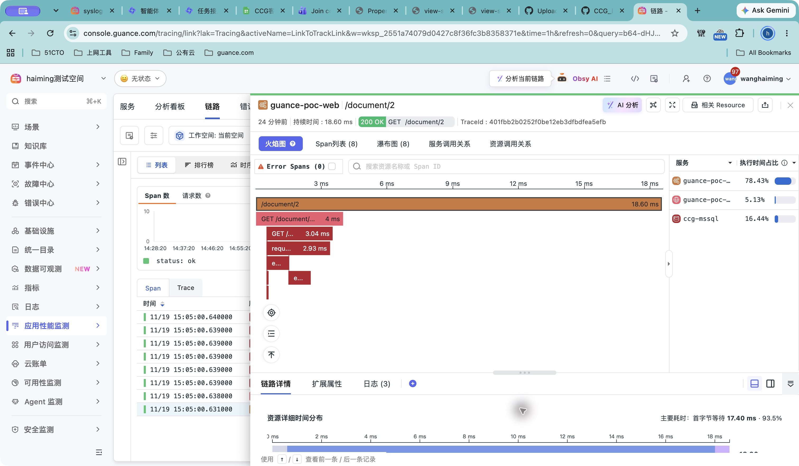
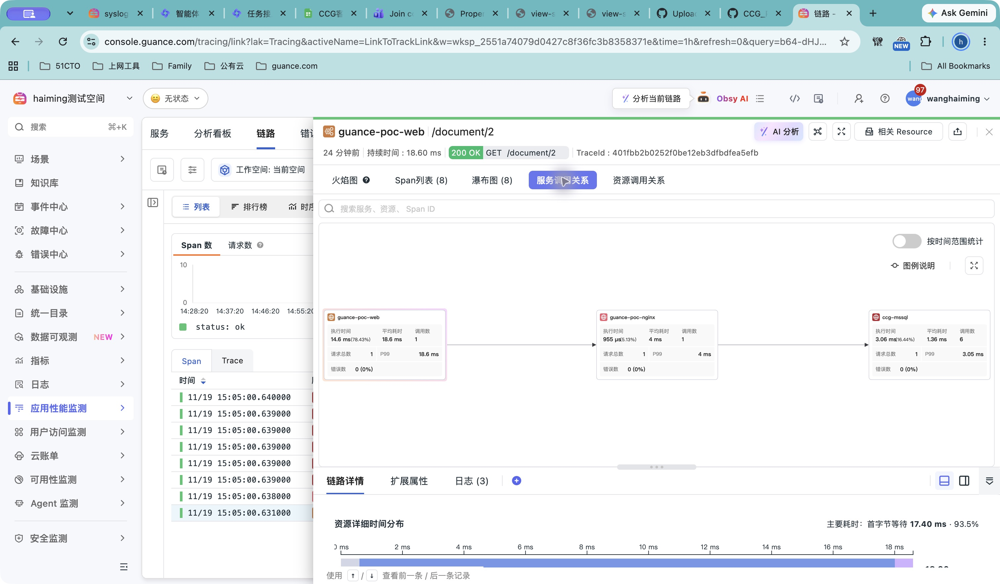
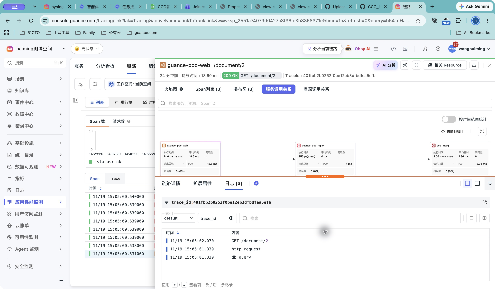
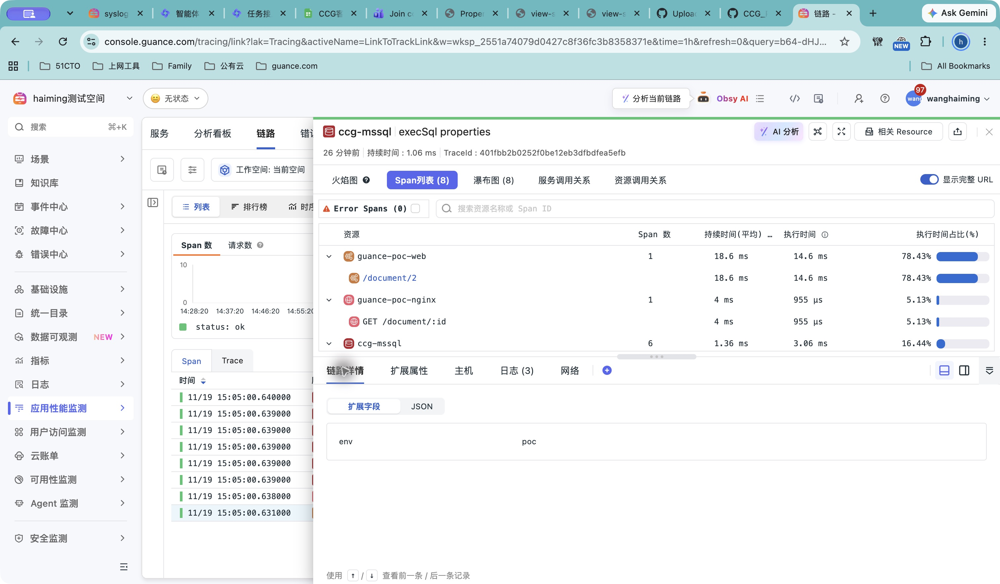
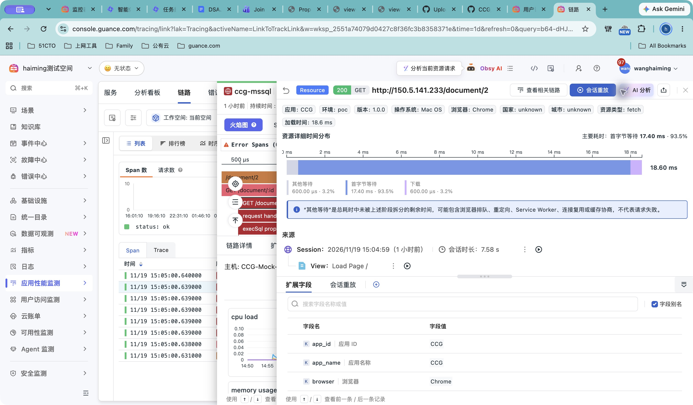
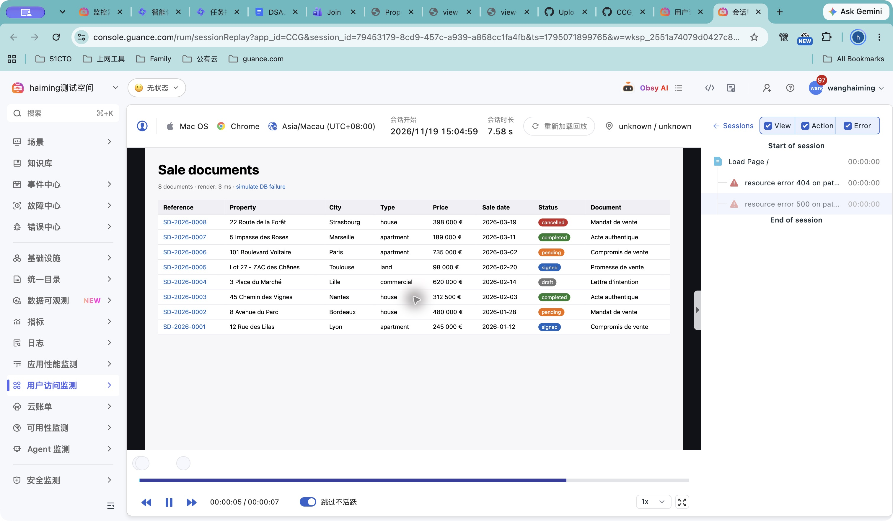
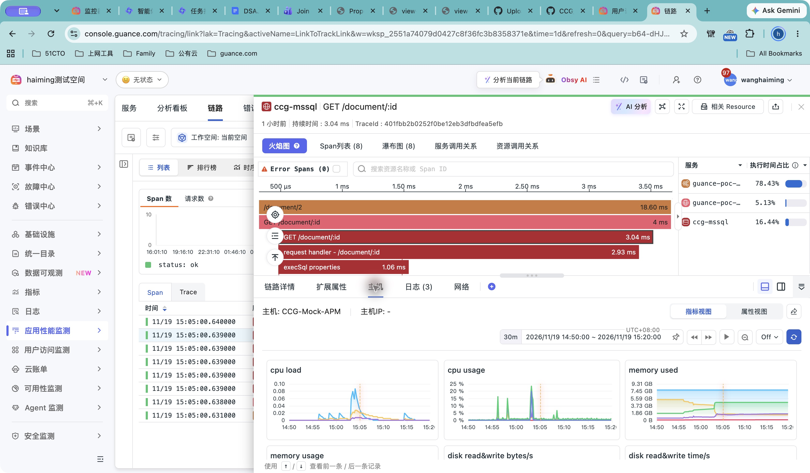

# CCG NodeJS MSSQL 全栈可观测部署报告

## 部署结果

已将仓库 NodeJS_MSSQL 项目部署到 http://150.5.141.233/ ，通过 Nginx 代理真实 Node.js 与 SQL Server 应用。原始提交为 cbd1cad5bb9c5a46f1a82b7df669029081dbca58，本地实施分支为 codex/nodejs-mssql-fullstack-observability。

代码目录为 /opt/ccg-poc/NodeJS_MSSQL，systemd 服务为 ccg-mssql，业务端口为 8080。数据库为同机 SQL Server 2022 Developer 容器 ccg-mssql-db，端口仅映射至 127.0.0.1:1433，具名卷为 ccg-mssql-data，内存上限 3 GB，SQL Server 内存配置为 2048 MB。实际镜像摘要为 sha256:4525e3efac9f3e241cb003bb2ff2a82818b502f37e12049d788b1a9fa7e13b7f。

采用本机 SQL Server 测试实例，连接参数从 /etc/ccg-mssql/app.env 读取。仓库示例中的 Azure SQL 地址与密码已替换为配置占位说明。数据库管理员、业务查询、监控查询分别使用独立账号，密码由服务器随机生成，根配置目录权限为 700、凭据文件为 600。Developer 版本用于演示测试。

## 数据流

```text
浏览器 RUM CCG
  → Nginx guance-poc-nginx
  → Express ccg-mssql
  → mssql / tedious SQL Span
  → SQL Server properties 数据库

Beacon Trace 与运行时指标 → DataKit OTLP gRPC 4317
Nginx Trace → DataKit OTLP gRPC 4317
RUM 与重放 → 同源 Nginx 接收路由 → DataKit 9529
应用日志、数据库日志、容器资源及 SQL Server 指标 → DataKit
DataKit → 观测云杭州 haiming测试空间
```

## 客户最关心的代码改动

唯一修改的业务源码为 `src/lib.js`：在原有日志函数中新增 7 行，读取 OpenTelemetry 当前 Span 的 trace_id、span_id，并补充标准日志字段。原来的日志调用点、HTTP 路由、HTML 页面和 SQL 查询保持原逻辑。

| 位置 | 具体改动 | 客户接入时是否需要改代码 |
| --- | --- | --- |
| src/lib.js | 日志注入 Trace/Span ID | **需要**，或在已有日志框架启用等价能力 |
| package.json / package-lock.json | Beacon 与 OTel API 依赖；修正 src/server.js 启动入口 | **需要调整依赖与启动配置** |
| Dockerfile | 安装步骤使用 npm ci | 构建配置调整 |
| .env.example | 数据库参数改为占位示例 | 环境参数调整 |
| Beacon HTTP/Express/tedious 插桩 | systemd NODE_OPTIONS 预加载 | 无需手写 Span |
| RUM 与会话重放 | Rumable/Nginx 注入 SDK | 无需修改 HTML 源码 |
| Nginx Trace、日志和指标采集 | 代理模块、DataKit 配置和数据库授权 | 运维配置 |

完整片段及逐文件解释见 [代码改动说明](代码改动说明.md)。Zero-code 自动链路采集并不代替现有 JSON 日志的上下文字段注入，这正是此次业务源码改动的目的。

## 实现改动

- 预加载 Beacon 2.0.2，启用 http、express、runtime-node、tedious 插件。
- 在现有 logLine 中补充标准日志字段及 OpenTelemetry Trace ID，保留原始 ts、level、msg、ctx。
- 修复 npm start 与 package main 的入口路径，生成依赖锁文件，Dockerfile 使用 npm ci。
- 保留源项目页面、健康检查与故障模拟行为，导入原项目 SQL 脚本中的 8 条记录。
- 使用已有 Nginx 1.30.7 与 ngx_otel_module 0.1.2，业务上游切换至 8080。
- RUM 沿用应用 CCG，采集会话重放，隐私级别 mask-user-input。
- 增加 SQL Server 指标采集、应用与数据库日志文件采集和应用日志轮转配置。

## 功能验证

共通过 18 项检查，包括列表、全部 8 个详情页、数据库健康、无效参数、404、单次故障、持续故障开启和恢复。完整结果见 observability/evidence/function-check.json。/health 返回数据库 up=true，故障模拟结束后正常访问恢复。

## 观测云入库验证

目标空间为杭州 haiming测试空间，UUID 为 wksp_2551a74079d0427c8f36fc3b8358371e。使用 Owl 数据域与来源发现、逐条 DQL 校验和只读查询。查询窗口为 2026-11-19T14:51:32.127000+08:00 至 2026-11-19T15:06:32.127000+08:00，窗口内数据代表本次样本，不用于推断长期运行质量。

| 数据域 | 实测结果 |
| --- | --- |
| MSSQL 链路 | 独立 execSql properties Span 已存在 |
| 全链路 | 浏览器、Nginx、Node.js 与数据库调用共享 Trace ID |
| 应用日志 | 41 条 info 与 4 条 error，其中包含故障演示和部署前健康探测 |
| 数据库日志 | ccg-mssql-db 来源返回 246 条记录 |
| 数据库指标 | sqlserver_metric 返回 user_connections、server_memory 实际样本 |
| 容器资源 | docker_containers 返回数据库容器内存实际样本 |
| Node.js 运行时 | otel_service 返回事件循环与 V8 堆空间样本，堆指标包含空间维度，单点不能作为堆总量 |
| Profile | ccg-mssql 返回 8 条 wall Profile |
| RUM | 新会话返回 1 个 View、6 个 Resource、2 条 session_replay、1 个 Long Task |

可复查成功 Trace ID 为 401fbb2b0252f0be12eb3dfbdfea5efb，故障 Trace ID 为 041f30aed599e00d01cc32b440e37e86。浏览器会话 ID 为 79453179-8cd9-457c-a939-a858cc1fa4fb。完整查询及响应保存在 observability/evidence/workspace.json，所有查询均通过校验。

## 观测云真实截图：浏览器到数据库

下列图片均为杭州 **haiming测试空间** 控制台实际截图，没有用绘图替代产品画面。样本发生于 2026-11-19 15:05（UTC+8），Trace ID 为 `401fbb2b0252f0be12eb3dfbdfea5efb`。



图 1：浏览器 Resource、Nginx 网关、Node.js HTTP/Express 与 SQL 调用出现在同一条链路中，共 8 个 Span。浏览器样本请求为 `/document/2`，整体耗时约 18.60 ms。本次使用原页面中的 Fetch 测试入口验证 Trace Context 传播；原有整页 HTML 链接没有改成 Fetch。



图 2：控制台「服务调用关系」显示 `guance-poc-web → guance-poc-nginx → ccg-mssql`。DataKit 使用 `split_service_name=false`，SQL 出口 Span 的 service 仍为 ccg-mssql，因此这里没有独立命名的 MSSQL 服务节点；数据库调用应在 SQL Span 中查看，不能把该图解释为独立数据库服务拓扑。



图 3：链路的日志页按同一 trace_id 查到网关与应用日志，包括 HTTP 请求和数据库查询日志。日志函数注入当前上下文后，可以从 Trace 直接检查关联日志，而不需要凭时间猜测同一请求。



图 4：选择 `execSql properties` 后可查看独立 SQL Span。该 Span 来自 tedious 自动插桩，没有在原 SQL 查询附近编写手动 Span。

## 前后端关联与会话重放



图 5：从后端 Trace 打开「相关 Resource」，可定位 CCG 应用中的 `/document/2` Fetch 请求，资源面板同时提供「查看相关链路」和「会话重放」。同一个资源关联到 15:04:59 开始的会话，耗时 18.60 ms，与浏览器根 Span 一致。



图 6：控制台实际播放会话 `79453179-8cd9-457c-a939-a858cc1fa4fb`，播放进度达到 00:00:05 / 00:00:07，页面中的 8 条原始文档可见。右侧时间线包含 favicon 404 与人为触发的数据库故障请求 500；其中 500 为验收故障演示。隐私策略已配置为 `mask-user-input`；原始应用没有输入表单，因此这张图证明普通内容可回放，不能作为表单遮盖的实测截图。

## 指标与链路的关联方式

指标按服务、主机和时间窗口聚合；本次没有为每个指标样本添加 trace_id。Node.js OTLP 指标使用 `service_name=ccg-mssql`，APM 与应用日志使用 `service=ccg-mssql`；数据库指标使用 `service=ccg-mssql-db`，网关使用 `service=guance-poc-nginx`，通过共同主机 `CCG-Mock-APM` 和时间窗口定位。



图 7：在 Node.js Span 的「主机 → 指标视图」直接查看 CCG-Mock-APM 的 CPU load、CPU usage 和 memory used，窗口自动定位到 Trace 前后 15 分钟（14:50–15:20）。这展示了从单次请求定位到同一运行环境资源指标的真实关联效果。

实际入库来源为 `otel_service`（运行时）、`tracing_metrics`（链路聚合）、`sqlserver_metric`（数据库）、`docker_containers`（容器）及主机采集器。验收样本和查询响应保存在 [evidence/workspace.json](evidence/workspace.json)、[数据库指标](evidence/db_metrics.json)、[运行时指标](evidence/runtime.json) 和 [容器指标](evidence/container.json)。这些证据说明有真实指标入库，但并不代表每类指标都具备逐条 Trace ID 关联。

## 运维与边界

SQL Server 使用自签名证书，应用与采集器在本机测试连接中配置信任该证书。客户正式环境应替换为其实际数据库地址与证书策略。heap Profile 沿用此前关闭配置，wall Profile 正常。会话重放已确认上报、入库并在控制台实际播放。SQL Server 深度 DBM、告警规则和专用仪表板未在本次部署中配置。

旧 SQLite Demo 的 guance-poc 服务已停止并取消自启，代码与数据库保留。需要回退时启动旧服务，将 Nginx 备份 nginx.before-mssql 中的业务上游恢复为 3000 并 reload。

## 客户复现

逐步操作、参数来源与配置文件位于 [部署操作说明](README.md)。客户需要替换工作空间 DataWay、RUM applicationId、公开域名、服务和主机标识，并按脚本在自己的服务器生成数据库凭据。完整凭据未纳入分支和交付包。

## 分支交付

实施分支为 `codex/nodejs-mssql-fullstack-observability`，通过已授权账号的 Fork `pipi0056/CCG_POC` 向原仓库 `CYSingAlex0706/CCG_POC` 的 main 提交 PR。本目录包含代码说明、部署模板、操作手册、实际入库证据与控制台截图；不包含工作空间 Token、API Key 或数据库真实密码。
