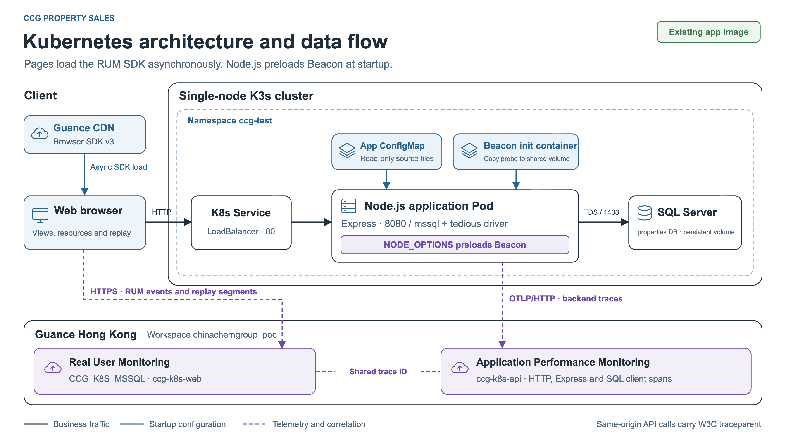

# Deploy CCG Property Sales with Guance on Kubernetes

[中文操作手冊](README.zh-CN.md) · [Validation results](docs/validation.en.md) · [Editable architecture diagram](docs/architecture.en.svg)



## Merge and deploy to test

Merge the PR into `CYSingAlex0706/CCG_POC:main`. Run the commands below on a workstation or CI runner with a kubeconfig for the target test cluster. Merging updates the repository. Running the deployment script publishes the release.

```bash
git clone --branch main https://github.com/CYSingAlex0706/CCG_POC.git
cd CCG_POC
kubectl config current-context
kubectl get nodes
kubectl get storageclass
./k8s/guance/deploy.sh
```

For an existing checkout, switch to `main` and run `git pull --ff-only origin main` before running the same script. The default namespace is `ccg-test`. To target a different namespace, set `NAMESPACE` for the script and substitute that name in the checks below.

### Cluster prerequisites

- Use a Linux amd64 node with capacity for SQL Server (2 GiB memory and 500 millicores requested), the web Pod and Kubernetes system Pods. Provide a default StorageClass that can provision a 10 GiB ReadWriteOnce volume. This release runs SQL Server 2022 Developer for development and testing.
- The runner needs Bash, OpenSSL and kubectl with Kustomize support. Its Kubernetes identity needs access to manage the namespace, Secrets, ConfigMaps, PVC, Services and Deployments, inspect Pods and execute commands inside them.
- Nodes pull pinned images from Docker Hub, GHCR and Microsoft Container Registry. The application connects over HTTPS to `cn6-openway.guance.one`. Browsers need HTTPS access to `static.guance.com` and `cn6-rum-openway.guance.one`.
- A LoadBalancer provides the web entry on port 80. On single-node K3s, make port 80 available. You can use the port-forward below to test from your workstation. SQL Server uses an internal ClusterIP.

### First deployment to a new namespace

The script prompts once for two values with hidden input. Obtain both from the **Hong Kong** workspace `chinachemgroup_poc`. For a migration, the workspace administrator can securely provision the values from the working deployment or the team's secret manager.

| Prompt | Where to obtain the value | Kubernetes Secret / key |
| --- | --- | --- |
| RUM Client Token | Real User Monitoring → Web application `CCG_K8S_MSSQL` → public DataWay integration. Use the browser Client Token bound to this application. | `guance-browser / client-token` |
| Workspace token | Management → Workspace Settings → Token. Use an active `tkn_` data-ingestion token for this workspace. | `guance-intake / otlp-headers` (script adds `X-Token=`) |

For CI, mount the two raw tokens as separate files from your secret manager and provide their paths:

```bash
RUM_TOKEN_FILE=/run/secrets/ccg-rum-client-token \
WORKSPACE_TOKEN_FILE=/run/secrets/ccg-workspace-token \
./k8s/guance/deploy.sh
```

The prepared test namespace already has both Secrets. Later releases reuse them and the SQL passwords. The script provisions the database, applies the repository's schema and sample documents, grants the application read access, waits for the rollout and checks the web page, MSSQL health and a known seed document.

## How the integration works

- **Browser.** The four static HTML pages and the Express `/legacy` template contain an asynchronous CDN script. [guance-rum.js](../../NodeJS_MSSQL/public/js/guance-rum.js) initializes the SDK using a same-origin browser token. Session, replay and tracing sample rates are 100% in test. Recording starts with `mask-user-input` privacy.
- **Application.** Kustomize mounts the tracked page files and template read-only into the customer's pinned `nodejs1.1` image. The Service routes directly to Node.js on port 8080. The Beacon init container copies the probe into a shared volume. `NODE_OPTIONS` preloads it before Express and the SQL driver, and spans are sent to Hong Kong DataWay using OTLP over HTTP.
- **Database calls.** The browser sends W3C `traceparent` on same-origin API requests. Beacon continues the trace through Express and the `tedious` driver. SQL client spans appear under the calling service `ccg-k8s-api`, including the time the application spends waiting for the database.

## Verify the release

```bash
kubectl -n ccg-test get pods,pvc,svc
kubectl -n ccg-test port-forward svc/properties-web-node 8080:80
```

1. Keep the port-forward running. In another terminal, run `curl -fsS http://localhost:8080/api/health` and `curl -fsS http://localhost:8080/api/documents`. Expect `data_mode=mssql`, `checks.db.up=true` and eight documents on a freshly seeded database.
2. Open `http://localhost:8080/sales.html` in a browser. After the CDN SDK loads, open a sales document. In Guance Hong Kong, select workspace `chinachemgroup_poc`, then Real User Monitoring → `CCG_K8S_MSSQL`. Select the last 15 minutes and open the new session. Look for the view, replay and document request under frontend service `ccg-k8s-web`.
3. Copy the document Resource's Trace ID. In Application Performance Monitoring → Traces, search for that ID. Expand the HTTP request under `ccg-k8s-api`, its Express request handler and its SQL child spans. [Verified example](docs/validation.en.md)

## Redeploy, troubleshoot and roll back

Rerun `./k8s/guance/deploy.sh` for subsequent releases. The script reuses the PVC and credentials. Updated frontend files generate a new ConfigMap and roll the web Pod. After rotating an ingestion credential, update its Secret and run `kubectl -n ccg-test rollout restart deployment/properties-web-node`.

```bash
kubectl -n ccg-test get events --sort-by=.lastTimestamp
kubectl -n ccg-test logs deploy/properties-web-node -c install-beacon
kubectl -n ccg-test logs deploy/properties-web-node -c web --tail=50
kubectl -n ccg-test logs deploy/properties-sql --tail=50
```

For a pending PVC, check the default StorageClass. For an image pull failure, inspect the Pod events and registry access. If the page works but telemetry is missing, check the workspace and time range, CDN loading, browser requests to `/v1/write/rum` and the API Pod's access to the Hong Kong OTLP endpoint.

To roll back the web application to the preceding available revision, run `kubectl -n ccg-test rollout undo deployment/properties-web-node` and check its rollout status. For a first release, scale the web Deployment to zero to stop serving traffic. Keep the PVC, SQL backup and both SQL Secrets together. Deleting the namespace also removes its Secrets and PVC; the storage reclaim policy controls the underlying volume.

[Guance Web SDK](https://docs.guance.com/real-user-monitoring/web/app-access/) · [Beacon for Node.js](https://docs.guance.com/beacon/nodejs/)
