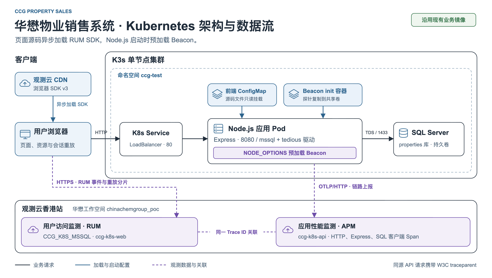

# 華懋測試環境 · Node.js、SQL Server 與觀測雲

[English deployment guide](README.md) · [驗收記錄](docs/validation.zh-CN.md) · [可編輯架構圖](docs/architecture.zh-CN.svg)



## 合併及發佈至測試叢集

在 GitHub 將 PR 合併至 `CYSingAlex0706/CCG_POC:main`。在已配置測試叢集 kubeconfig 的工作機或 CI runner 執行下列命令。合併完成後，部署腳本負責將該版本發佈到叢集。

```bash
git clone --branch main https://github.com/CYSingAlex0706/CCG_POC.git
cd CCG_POC
kubectl config current-context
kubectl get nodes
kubectl get storageclass
./k8s/guance/deploy.sh
```

如使用已有的工作目錄，切換至 main 後先執行 `git pull --ff-only origin main`，再執行部署腳本。

預設命名空間為 `ccg-test`。腳本會沿用叢集內的觀測雲憑證與 SQL Server 資料卷，等候應用就緒，並透過應用 API 核對資料庫模式和種子文件。原先的 `k8s/nodejs-apm.yaml` 仍可單獨用於記憶體模式。

## 第一次發佈至另一個測試叢集

- 需要 Linux amd64 節點、可動態配置 10 GiB RWO 卷的預設 StorageClass、LoadBalancer 控制器，以及 Bash、OpenSSL 和支援 Kustomize 的 kubectl。資料庫使用 SQL Server 2022 Developer，供開發及測試使用。腳本建立的 SQL 服務僅在叢集內開放。
- 叢集須能拉取 Docker Hub、GHCR 與 Microsoft Container Registry 的鏡像，應用須能以 HTTPS 連線至香港 OTLP 入口。使用者的瀏覽器須能連線至 `static.guance.com` 與 `cn6-rum-openway.guance.one`。
- 首次執行時依隱藏提示輸入兩項憑證。第一項為香港工作空間 `chinachemgroup_poc` 的 Web 應用 `CCG_K8S_MSSQL` 專用 Client Token，第二項為同一空間「管理 → 空間設置 → Token」中的資料寫入 Token。可從已部署環境的密鑰管理系統同步這兩個 Secret。
- 在 CI 中可設定 `RUM_TOKEN_FILE` 與 `WORKSPACE_TOKEN_FILE` 指向祕密管理系統掛載的純文字檔案。請將憑證保存在 Git 以外。瀏覽器只能取得 RUM Client Token，後端寫入 Token 只交給應用容器內的 Beacon。
- 如需獨立命名空間，可在首次發佈時指定 `NAMESPACE`。使用單節點 K3s 時，應為 LoadBalancer 保留 TCP 80。若已有 Ingress 或負載平衡器佔用該連接埠，可透過下方 port-forward 核驗服務。

SQL 容器申請 2 GiB 記憶體及 500m CPU；節點還需容納 Web Pod 和叢集系統元件。部署帳號需要管理命名空間、Secret、ConfigMap、PVC、Service、Deployment，以及查看 Pod 和執行 Pod 內命令的權限。

腳本將兩項憑證分別存入 `guance-browser/client-token` 及 `guance-intake/otlp-headers`。CI 可使用以下命令，兩個檔案分別存放原始 Token。腳本自動為後端 Token 加入 `X-Token=`。

```bash
RUM_TOKEN_FILE=/run/secrets/ccg-rum-client-token \
WORKSPACE_TOKEN_FILE=/run/secrets/ccg-workspace-token \
./k8s/guance/deploy.sh
```

## 本次改動

| 元件 | 執行方式 |
| --- | --- |
| 業務應用 | 使用客戶發佈的 `properties-web:nodejs1.1`，以摘要固定版本。預設清單的舊 `:nodejs` 映像缺少此版本的靜態頁面。 |
| 瀏覽器 RUM | 四個靜態頁面和 `/legacy` 模板在頁首以 `<script async>` 載入官方 CDN SDK。`public/js/guance-rum.js` 從同源讀取瀏覽器專用 Client Token，初始化 SDK 並啟動重放。測試叢集透過 Kustomize 將這些版本控制中的原始檔案唯讀掛載到原有映像，Service 直接轉發至 Node.js 8080。 |
| 後端 APM | `web.yaml` 以 init container 複製 Beacon Node.js 2.0.2，透過 NODE_OPTIONS 在 Express 及 MSSQL 驅動程式載入前啟動探針。鏈路透過 OTLP/HTTP 直送香港 DataWay。 |
| MSSQL | `database.sh` 使用專案原有的 `NodeJS_MSSQL/db/MMSQL.sql` 建立資料表與示範文件。應用使用唯讀帳戶，管理員密碼與應用密碼分開存放。重新發佈會沿用 PVC 與 Secret。 |

## 如何查看資料

1. 執行 `kubectl -n ccg-test get svc properties-web-node` 取得測試入口。也可執行 `kubectl -n ccg-test port-forward svc/properties-web-node 8080:80`，透過瀏覽器開啟 `http://localhost:8080/sales.html`。選取銷售文件以產生一次查詢。
   在另一終端執行 `curl -fsS http://localhost:8080/api/health` 與 `curl -fsS http://localhost:8080/api/documents`。應看到 data_mode=mssql、checks.db.up=true，首次初始化後有 8 筆示範文件。
2. 在觀測雲香港站登入 `chinachemgroup_poc`，於「用戶訪問監測」開啟 `CCG_K8S_MSSQL`。選擇最近 15 分鐘，查看 View 與 Resource，前端服務名為 `ccg-k8s-web`。
3. 於「應用性能監測 → 鏈路」篩選 `service=ccg-k8s-api`，查看 `GET /api/documents` 的 HTTP、Express 與 SQL 查詢。RUM 啟動後，同源 API 請求會帶 W3C traceparent，可用 Resource 的 Trace ID 比對後端鏈路。
4. 本測試環境將會話、重放與前後端追蹤採樣均設為 100%。SDK 初始化後即開始錄製，以 mask-user-input 遮蔽輸入值。進入該次會話的「會話重放」即可查看操作，再從 Resource 的 Trace ID 查看後端處理。若只看見頁面而沒有鏈路，重新整理銷售頁，待 SDK 載入後再查詢一次文件。瀏覽器 Network 可檢查 CDN 與 `/v1/write/rum` 回應。

SQL 客戶端 Span 歸屬於執行查詢的 Node.js 服務 ccg-k8s-api，可用來查看應用等待資料庫的時間。

## 重發佈及排查

執行同一條部署命令可重發佈。變更 RUM 腳本會產生新 ConfigMap 並觸發 Pod 更新。若在叢集外輪換了 Token，請先更新對應 Secret，再執行 `kubectl -n ccg-test rollout restart deployment/properties-web-node`。備份時請一起保留 SQL 資料與兩個 SQL Secret。

```bash
kubectl -n ccg-test get pods,pvc,svc
kubectl -n ccg-test get events --sort-by=.lastTimestamp
kubectl -n ccg-test logs deploy/properties-sql --tail=50
kubectl -n ccg-test logs deploy/properties-web-node -c install-beacon
kubectl -n ccg-test logs deploy/properties-web-node -c web --tail=50
```

PVC 長時間 Pending 時，請檢查預設 StorageClass。拉取鏡像失敗時，請檢查 Pod 事件和登錄檔連線。若看不到觀測資料，請核對工作空間、時間範圍、瀏覽器 SDK 與上報請求，以及 Pod 到香港 OTLP 入口的連線。

如需回到上一個應用版本，使用 `kubectl -n ccg-test rollout undo deployment/properties-web-node`。首次發佈若要停止對外服務，可將該 Deployment 的副本數調為 0。刪除命名空間會連同資料卷聲明與 Secret 一起移除。

相關文件可參閱[觀測雲 Web 應用接入](https://docs.guance.com/real-user-monitoring/web/app-access/)及[Beacon Node.js](https://docs.guance.com/beacon/nodejs/)。
